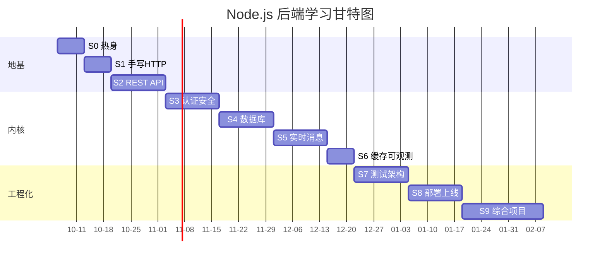

# Node.js 后端实战学习计划（前端转型版）

> 核心原则：**不学"知识点"，只学"解决需求需要的那部分知识"。**
> 每一关都是：先拿到一个真实后端需求 → 自己写 → 卡住 → AI 辅助 → 验收 → 复盘。
> 前后端本质差别不在语言（都是 JS/TS），而在**状态、并发、数据一致性、安全、部署**这五件事。

## 0. 适配假设（不符合就改，见 [[#9. 如何按自己的情况调整]]）

| 维度 | 假设 | 依据 |
| --- | --- | --- |
| 已有基础 | 熟练 JS/TS、会用 npm、懂 HTTP 与 Promise | 前端日常 |
| 投入时间 | 每周 10~15 小时（工作日 1.5h + 周末 4h） | 在职学习 |
| 总周期 | 18 周（可压缩到 12 周或拉长到 24 周） | 见排期表 |
| 技术栈 | TypeScript + Node 22 + Express→NestJS + PostgreSQL + Redis + Prisma | 见 [[#1. 技术栈选型]] |
| 学习方式 | AI 结对：先写后问，AI 只做"讲师 / 审查者 / 陪练"，不做"代写器" | 见 [[#3. AI 辅助学习方法论]] |

## 1. 技术栈选型（一条主线，不做多选题）

一套栈走到底，中途不换，避免"教程地狱"。

| 层 | 选择 | 为什么 | 备选 |
| --- | --- | --- | --- |
| 运行时 | Node.js 22 LTS | 直接用你已装的 | — |
| 语言 | TypeScript（`strict: true`） | 前端已有 TS 心智，不吃亏 | — |
| 语言服务 | **Express 5**（S1–S4）→ **NestJS**（S7–S8） | 先用 Express 看清底层，再用 Nest 学企业分层 | Fastify |
| 数据库 | **PostgreSQL** | 生产主流、类型强、JSON 与全文检索够用 | MySQL 8（提示词改一下即可） |
| ORM | **Prisma**（先）→ 手写 SQL（后） | 迁移和类型体验好；必须能手写 SQL 才不算虚 | Drizzle / Kysely |
| 缓存/队列 | Redis + BullMQ | 缓存 + 异步任务一起解决 | — |
| 校验 | Zod | 和前端共用一套 schema | class-validator |
| 测试 | Vitest + Supertest | 你大概率已经会 Vitest | Jest |
| 日志 | Pino | 快、结构化 | Winston |
| 部署 | Docker + Compose + Nginx + GitHub Actions + 一台云服务器 | 全链路自己走一遍 | Render / Railway |

> 数据库学习曲线较陡，如果 3 周后仍不适应，先降级用 **SQLite + Prisma** 把 S4 跑通，S6 再切 PostgreSQL。别在环境上耗超过 2 天。

## 2. 学习地图与排期

三条主线交替，防止只写业务不懂原理。

```text
阶段一 打地基（看懂地基长什么样，4 周）
  S0 热身周        把 JS 运行时 / 异步 / 模块系统补到位            [1 周]
  S1 手写 HTTP     不装框架，用 node:http 手工实现路由和静态服务   [1 周]
  S2 REST API      用 Express 做一个真业务的分层 API               [2 周]

阶段二 后端内核（后端的难点都在这里，7 周）
  S3 认证与安全    JWT / RBAC / 密码哈希 / 限流 / 错误处理         [2 周]
  S4 数据库与 ORM  建模、迁移、事务、索引、N+1                     [2 周]
  S5 实时与消息    WebSocket 多房间 / Redis Pub-Sub / 队列          [2 周]
  S6 缓存与可观测  缓存策略、BullMQ 异步任务、日志与压测            [1 周]

阶段三 工程化与上线（把东西交付出去，7 周）
  S7 测试与架构    Vitest 覆盖 + NestJS 重写核心接口                [2 周]
  S8 上生产        Docker、Nginx、CI/CD、监控、上线真实域名         [2 周]
  S9 综合项目      从零到上线一个属于你自己的完整产品               [3 周]
```

### 排期表（可直接当周计划用）

| 周 | 阶段 | 本周产出（必须能跑起来的东西） | 文档 |
| --- | --- | --- | --- |
| W1 | S0 | 一个 CLI 小工具 + 一份"JS 后端视角"笔记 | [[S0 Node 后端热身]] · [[S0 逐日任务清单]] |
| W2 | S1 | 不依赖框架的静态文件 + JSON API 服务器 | [[S1 手写 HTTP 服务器]] |
| W3–4 | S2 | 带分层结构的 REST API（含分页、校验、错误规范） | [[S2 第一个 REST API]] |
| W5–6 | S3 | 注册登录 + JWT + RBAC + 限流 | [[S3 认证授权与安全]] |
| W7–8 | S4 | PostgreSQL 建模 + 迁移 + 事务 + 索引优化报告 | [[S4 数据库与 ORM]] |
| W9–10 | S5 | 多房间 WebSocket 聊天 + Redis 广播 | [[S5 实时通信与消息]] |
| W11 | S6 | 缓存层 + 邮件/图片异步任务 + 压测报告 | [[S6 缓存异步与可观测]] |
| W12–13 | S7 | 测试覆盖率 ≥ 70% + NestJS 版核心模块 | [[S7 测试与架构升级]] |
| W14–15 | S8 | Docker 镜像 + CI/CD + 线上可访问域名 | [[S8 部署与上线]] |
| W16–18 | S9 | 综合项目上线 + 复盘文档 | [[S9 综合项目与复盘]] |



## 3. AI 辅助学习方法论

这是整套计划里最值钱的部分。用错 AI，你会"看起来学会了，实际写不出"。

### 3.1 铁律：AI 的使用顺序

```text
需求 → 自己拆解 (15~30min) → 写出第一版（哪怕是错的） → 写出你的疑问
     → 问 AI（描述代码 + 你的假设 + 具体问题） → 对照改动 → 关掉 AI 重写一遍 → 记录到笔记
```

**禁止清单**（做了就等于没学）：

- ❌ 让 AI 直接生成整个项目 / 整个模块，自己只是复制粘贴运行
- ❌ 报错后不做任何分析就把错误原文丢给 AI 说"修一下"
- ❌ 看到 AI 给的代码就信，不验证它是否真的符合你的项目上下文
- ❌ 用 AI 回答替代官方文档（AI 会编造 API 签名和配置项）

**正确姿势**：AI 的最佳角色是 —— ① 出题人 ② 代码审查员 ③ 报错讲解员 ④ 面试官 ⑤ 术语翻译官。

### 3.2 每天 90 分钟的标准循环

| 时段 | 动作 | 说明 |
| --- | --- | --- |
| 0–10 min | 复述昨天 | 不看笔记，口头/文字说出昨天学的 3 个概念 |
| 10–60 min | 写需求 | 只查官方文档，卡住先自己想 10 分钟 |
| 60–75 min | 问 AI | 用 [[AI 提示词库]] 里的模板，带上代码和你自己的猜测 |
| 75–90 min | 写复盘 | 追加到本周笔记的"复盘"区，只写踩坑与结论 |

### 3.3 每周 30 分钟"AI 考我"

把本周代码丢给 AI，用这个模板：

```text
你是后端面试官。下面是我这周写的代码（贴代码）。
请出 5 道题考我，从"这段代码为什么这么写"到"换一个流量规模会怎么崩"。
一次只问一道，等我回答后再问下一道，我答错时不要直接给答案，先给我一个提示。
```

### 3.4 防止"AI 幻觉"的三步验证

1. **查文档**：任何 API / 配置项，去官方文档确认签名与版本（Node 22、Express 5、Prisma 6）。
2. **写最小复现**：单独建一个 10 行脚本验证 AI 说的行为，跑通再进项目。
3. **反向解释**：把 AI 的代码用自己的话写一遍注释，解释不了的就去问"这行为什么这么写"。

## 4. 进度追踪

- [ ] S0 热身周完成
- [ ] S1 手写 HTTP 服务器完成
- [ ] S2 REST API 完成
- [ ] S3 认证授权与安全完成
- [ ] S4 数据库与 ORM 完成
- [ ] S5 实时通信与消息完成
- [ ] S6 缓存异步与可观测完成
- [ ] S7 测试与架构升级完成
- [ ] S8 部署上线完成
- [ ] S9 综合项目上线
- [ ] 全部 10 份复盘笔记写完
- [ ] 简历上出现"Node.js 后端项目"一行，并能答出全部技术选型理由

## 5. 每个阶段统一的验收套路

每关结束时必须同时满足：

1. **能跑**：`pnpm dev` 起来，且按验收清单逐条演示通过（不能"理论上可以"）。
2. **能测**：至少覆盖核心分支的自动化测试，不是手点。
3. **能讲**：能不看代码画出数据流图，说出每层的职责与失败时的表现。
4. **能复盘**：阶段文档最后"复盘"区有自己的文字，不是抄 AI 的总结。
5. **能过题**：AI 面试官那 5 题至少答对 4 题。

> 缺任何一条，不要进入下一阶段。跳关是这类学习计划失败的头号原因。

## 6. 综合项目选题（S9 用，越早定越好）

选一个**你自己会每天用**的产品，这是能坚持 3 周的唯二理由之一（另一个是有明确上线目标）。

| 候选 | 后端亮点 | 难度 |
| --- | --- | --- |
| 个人知识库 / 笔记同步服务 | 全文检索、版本历史、多端同步冲突 | ⭐⭐⭐ |
| 团队看板（类 Trello） | 实时协作、拖拽事件顺序、权限模型 | ⭐⭐⭐⭐ |
| RSS/内容聚合 + 定时抓取 | 队列、去重、定时任务、抓取限速 | ⭐⭐⭐ |
| 本地小工具的服务端（书签、账单、密码本） | 简单但要上线、要备份、要安全 | ⭐⭐ |
| 小程序 / 管理后台的完整后端 | 最贴近就业，但需配前端 | ⭐⭐⭐ |

**推荐**：`团队看板` 或 `内容聚合`，两者都能自然覆盖认证、实时、队列、缓存、部署五大考点。

## 7. 里程碑（对外可展示的成果）

| 里程碑 | 时间点 | 证据 |
| --- | --- | --- |
| M1 能自己写出无框架 HTTP 服务 | W2 | Git 仓库 + 笔记 |
| M2 能独立交付带认证的 REST API | W6 | Postman/HTTPie 集合 + 测试 |
| M3 能设计数据库并解释索引选择 | W8 | ER 图 + `EXPLAIN ANALYZE` 报告 |
| M4 项目能在 Docker 与公网运行 | W15 | 可访问 URL + CI 绿色徽章 |
| M5 综合项目上线并写完整技术文档 | W18 | README + 架构图 + 复盘 |

## 8. 常见失败模式（提前打疫苗）

| 症状 | 真实原因 | 对策 |
| --- | --- | --- |
| 卡在环境配置一周 | 追求"完美环境" | Docker 起数据库，2 天不通就换 SQLite |
| 教程看完还是不会写 | 只看不写 | 每关必须先自己写 60 分钟再看任何教程 |
| 大量用 AI 生成，代码看不懂 | 把 AI 当代写器 | 遵守 [[#3.1 铁律：AI 的使用顺序]]，关掉 AI 重写 |
| 学到一半失去动力 | 项目是虚构的 | 换成自己每天要用的产品 |
| 只会 CRUD，不懂原理 | 没有 S1/S4 的地基 | 不许跳过 S1 和 S4 |
| 上线永远往后拖 | 完美主义 | S8 强制部署到公网，哪怕只有 HTML 首页 |

## 9. 如何按自己的情况调整

- **时间只有 5h/周**：砍掉 S9 的一部分，保留 S0–S8，周期拉到 28 周。
- **想 3 个月速成换工作**：S0/S1 各压到 3 天，S7 的 NestJS 改为只读官方文档不动手，把时间全给 S9 项目 + 面试题。
- **已会数据库**：S4 压缩为 1 周，重点只做事务与索引。
- **目标是大厂/中型厂**：S7 的 NestJS、S8 的 CI/CD 与监控不能省，这是面试高频。
- **目标是接外包/独立开发**：重点转移到 S8 部署、S9 交付、以及支付/多租户/文件存储（去 [[AI 提示词库]] 要延伸需求）。

## 10. 文件索引

- [[S0 Node 后端热身]] —— 运行时、异步、模块、进程
- [[S0 逐日任务清单]] —— W1 每天 3 件可验证的小事（**从这份开始**）
- [[S1 手写 HTTP 服务器]] —— 不装框架，理解请求响应
- [[S2 第一个 REST API]] —— Express、分层、校验、错误规范
- [[S3 认证授权与安全]] —— JWT、RBAC、哈希、限流
- [[S4 数据库与 ORM]] —— 建模、迁移、事务、索引、N+1
- [[S5 实时通信与消息]] —— WebSocket、Redis、Pub/Sub
- [[S6 缓存异步与可观测]] —— 缓存、BullMQ、日志、压测
- [[S7 测试与架构升级]] —— Vitest、NestJS、分层与依赖注入
- [[S8 部署与上线]] —— Docker、Nginx、CI/CD、监控
- [[S9 综合项目与复盘]] —— 选题、迭代计划、上线与复盘
- [[AI 提示词库]] —— 全流程可直接复制的提示词

> 用法：每周一打开对应阶段文档，把"任务清单"里当周项拆成每日 3 个小任务（用 `04 Templates/每日任务`），做完就勾掉。
