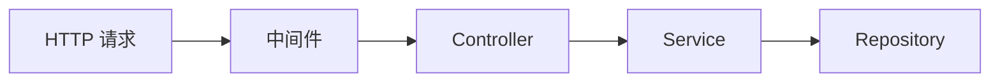

# S2 · 第一个 REST API（2 周）

> 目标：交付一个**有真实业务、有分层结构、别人能接手**的 REST API。
> 这是你第一个能写进简历的后端项目。重点不是功能多，而是**结构对、边界清楚**。

## 实战需求

**选题：个人知识库 API（`kb-api`）** —— 理由：业务你熟，注意力全放在后端工程上；且 S4 之后可直接长出综合项目。

功能范围：

1. **笔记 CRUD**：创建 / 查询列表 / 查询详情 / 更新 / 删除（软删除）
2. **标签**：一篇笔记多个标签，按标签筛选笔记
3. **搜索**：标题 + 内容关键词（先内存过滤，S4 换数据库）
4. **分页与排序**：`?page=1&pageSize=20&sort=-createdAt`，返回 `{ items, total, page, pageSize }`
5. **统一响应与错误规范**：成功 `{ data, meta }`；失败 `{ error: { code, message, details, traceId } }`
6. **参数校验**：用 Zod 校验 body / query / params，错误信息可定位到字段
7. **分层结构**：route → controller → service → repository，禁止 controller 里写 SQL、service 里碰 `req`
8. **配置管理**：`.env` + 启动时校验必需变量，缺失就拒绝启动
9. **API 文档**：一份可执行的 HTTP 请求集合（HTTPie/REST Client 文件或 OpenAPI）

## 知识点与前端对照

| 知识点 | 前端视角 | 本周要做到 |
| --- | --- | --- |
| REST 设计 | 后端给的接口随便调 | 资源命名、复数、嵌套层级不超过 2 层、动作用子资源或 PATCH |
| 分层架构 | 组件 / hooks / api 层 | route(路由) / controller(解析请求) / service(业务) / repository(数据) |
| DTO 与校验 | 表单校验 | 校验是**服务端**的安全边界，前端校验只是体验 |
| 错误处理 | try/catch | 错误分类（业务错误 vs 系统错误）、集中处理、不把堆栈泄漏给客户端 |
| 配置 | 环境变量在 Vite | 12-Factor、启动即校验、`NODE_ENV` 下的行为差异 |
| 日志 | console.log | 结构化日志、requestId 贯穿、日志级别 |
| 分页 | 前端切片 | 偏移分页 vs 游标分页，怎么算 total，深分页为什么慢 |
| HTTP 语义 | 都用 POST | PUT vs PATCH、DELETE 的幂等性、201 + Location |
| 幂等 | 没概念 | 重复提交、重试导致的重复创建，用唯一约束或幂等键解决 |

## 任务清单（按天）

**第 1 周：骨架与 CRUD**

- [ ] D1 项目脚手架：TS + Express 5 + Zod + tsx + `pnpm dev`，目录结构定稿（`src/{routes,controllers,services,repositories,middlewares,schemas,lib,types}`）
- [ ] D2 配置与日志：`src/config`（启动校验 env）+ Pino + requestId 中间件
- [ ] D3 统一响应与错误：定义 `AppError`、`errorHandler`、`notFoundHandler`，把所有响应收口
- [ ] D4 数据层（先内存）：`repository` 接口 + `InMemoryRepository` 实现，为 S4 换数据库预留接口
- [ ] D5 笔记 CRUD 全通：POST/GET/GET:id/PATCH/DELETE，POST 返回 201 + Location
- [ ] D6 校验：Zod schema 覆盖全部入参，错误转成字段级 `details`；写 5 个非法请求的 curl 用例
- [ ] D7 本周复盘 + 补测试：Supertest 覆盖 CRUD happy path

**第 2 周：进阶语义**

- [ ] D8 分页/排序/筛选：统一 query 解析工具，防负数与超大 pageSize（上限 100）
- [ ] D9 标签与关联：多对多语义（先内存），按标签筛选
- [ ] D10 软删除：`deletedAt`、列表默认排除、`?includeDeleted=true`
- [ ] D11 搜索：关键词匹配 + 简单高亮标记；记录"这套实现换到数据库会怎么做"
- [ ] D12 幂等与并发：给"创建"加幂等键（`Idempotency-Key` 头 + 内存 Map），演示重复请求只创建一次
- [ ] D13 错误路径压测：把 repository 改成随机抛错，验证 500 响应结构正确、日志有 traceId、进程不挂
- [ ] D14 文档与收尾：写 API 文档、README（含启动步骤与目录说明）、录一个 3 分钟自演示

## 验收标准

- [ ] 冷启动 30 秒内能跑起来（有一条命令的 README）
- [ ] 所有接口用 HTTPie/REST Client 文件一键重现
- [ ] 任意非法输入都不会出现 500（除非是真实系统错误）
- [ ] 所有错误响应含 `traceId`，且能在日志里用该 id 检索到完整上下文
- [ ] 依赖方向检查：controller 不 import repository，service 不 import express 的 `Request`
- [ ] 能画出请求生命周期图并指出每层的失败表现
- [ ] 能回答：为什么校验必须在服务端做？为什么错误不该直接 `res.send(err.message)`？

## 分层写法示例（自己写完后对照）

```text
routes/notes.route.ts        →  只做"路径到 controller 的映射"
controllers/notes.controller →  解析 req（params/query/body），调用 service，组织响应
services/notes.service       →  业务规则（软删除逻辑、权限判断、幂等），不认识 HTTP
repositories/notes.repo      →  只管存取，接口化，S4 时可替换为 Prisma 实现
schemas/notes.schema.ts      →  Zod，入参的唯一真相
middlewares/                 →  横切关注点：日志、鉴权、错误、限流
lib/                         →  AppError、response helper、id 生成、时间
```

## 常见坑

1. **controller 里直接写业务** —— 三周后你自己都改不动，S4 换数据库会推倒重来。
2. **`async` 中间件抛错不传给错误处理器** —— Express 5 已支持 promise 拒绝自动转 next，但仍要确认版本行为并写测试。
3. **返回实体时把内部字段一起吐出去**（如 `deletedAt`、内部 id、密码）—— 要有显式 DTO/serializer。
4. **分页 `total` 每次全表 count** —— S4 会讲代价，现在先记下疑问。
5. **PATCH 语义错**：PATCH 只改传入字段，missing 与 `null` 必须区分（用 `z.optional()` vs `z.nullable()`）。
6. **异步删除后立刻查询** —— 软删除要在 repository 层统一过滤，别在每个 service 里记得写。
7. **`.env` 提交进 Git** —— 立刻写 `.gitignore`，并提交一份 `.env.example`。

## AI 协作提示词

**架构评审（每周一次，别天天用）：**
```text
这是我的目录结构和分层依赖（贴 tree + 关键 import）。
请以"三个月后要换掉数据层"为前提，指出我的分层里哪些地方会造成改动扩散，最多 3 条，每条给出最小改法。
不要重写项目，不要给完整文件。
```

**扮演苛刻的 Code Reviewer：**
```text
下面是我的 PATCH /notes/:id 的 controller 和 service（贴代码）。
请扮演严格但克制的后端 reviewer，只挑"会导致线上 bug 或安全问题的"问题，最多 5 条，
每条格式：问题 / 触发场景 / 修复方向（一句话）。不要给完整代码。
```

**解释性学习：**
```text
用"如果我这个 API 每天有 100 万次请求"的视角，解释我现在的分页实现会在哪一步先撑不住，
给出 3 个可量化的瓶颈点（越具体越好，比如内存、IOPS、响应体大小）。
```

**出题（周末）：**
```text
根据我这两周的代码（贴关键文件），出 5 道代码审查题：每道给一段有缺陷的代码（可以基于我的代码改造），
让我找出问题。一次一道，我答完再给下一道。
```

## 复盘（自己写）

### 我的分层图（文字或 Mermaid）


### 被 AI 指出的问题里，我认同的 / 不认同的
-

### 如果重做一次，我会先定下来的三件事
-
