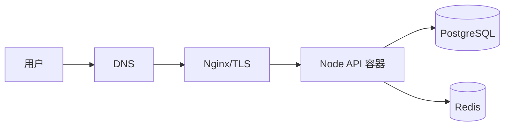

# S8 · 部署与上线（2 周）

> 目标：**把项目放到公网上，让别人能用 URL 打开。**
> 这一步 90% 的自学者会拖到最后不了了之。它是"学过"和"做过"的分界线，也是面试里最好讲故事的部分。

## 实战需求

1. **容器化**：
   - 多阶段 Dockerfile（builder 装依赖编译 TS → runner 只带产物与生产依赖）
   - 非 root 用户运行、镜像体积优化（目标 < 200MB）、`.dockerignore`
   - `docker compose` 一键起 API + PostgreSQL + Redis + Nginx
   - 生产镜像用 `node:22-slim`，禁止在容器里跑 `pnpm dev`
2. **Nginx 反代**：
   - 反向代理到 API、`gzip`、静态资源缓存头
   - WebSocket 升级透传（`Upgrade` / `Connection` 头）
   - 请求体大小限制、超时配置、真实 IP 透传（`X-Forwarded-For`）
3. **HTTPS**：
   - 申请域名 + Let's Encrypt 证书（Certbot），配置 HTTP → HTTPS 跳转
   - HSTS、TLS 版本限制
4. **CI/CD（GitHub Actions）**：
   - PR：lint + typecheck + test（S7 已建）
   - main 分支：构建镜像 → 推送到镜像仓库（GHCR）→ SSH 到服务器拉取并重启
   - 迁移在部署流程里自动执行（`prisma migrate deploy`），带失败即停
5. **运维基础**：
   - 环境变量与密钥不进仓库（`.env.example` + 服务器端 `.env`，权限 600）
   - 进程守护与自启（Docker restart policy 或 systemd）
   - 日志集中查看、磁盘占用监控（`docker system df`）
   - 数据库定时备份（cron + `pg_dump` + 保留 N 天）+ **恢复演练**
   - 一键回滚方案（保留上一个镜像 tag）
6. **上线验收**：把 S9 要做的项目的骨架先部署上去（先跑通，功能随后填）

## 知识点与前端对照

| 知识点 | 前端视角 | 后端本周要掌握 |
| --- | --- | --- |
| 构建产物 | Vite build 出静态文件 | Node 要打包还是只编译 TS？`dependencies` vs `devDependencies` 的运行时意义 |
| 环境差异 | `.env.development` | 12-Factor：配置从环境注入，镜像不含配置 |
| 容器 | 只用来起数据库 | 镜像分层缓存、多阶段构建、容器网络、持久化卷 |
| 反向代理 | 没接触过 | Nginx 是唯一入口的原因（TLS、压缩、限流、静态、WS 升级） |
| 端口与网络 | localhost 就行 | 容器内 `localhost` 不是宿主机；服务名即 DNS |
| CI/CD | 手动 build 上传 | 流水线门禁、构建产物版本化、部署幂等、回滚 |
| 迁移 | 改代码 | 生产用 `migrate deploy`，且必须在应用启动前完成 |
| 密钥管理 | `.env` 随便放 | 服务器文件权限、不打印、不进镜像、定期轮换 |
| 监控告警 | 无 | 存活探测、日志告警、磁盘水位、证书到期提醒 |
| 备份 | 没做过 | 备份 ≠ 可用；只有恢复验证过才算有备份 |

## 任务清单（按天）

**第 1 周：容器与本地生产化**

- [ ] D1 采购云服务器（2C2G 起）、配置 SSH 密钥登录、禁用密码登录、装 Docker
- [ ] D2 多阶段 Dockerfile + `.dockerignore`；本地 `docker build` 并对比体积
- [ ] D3 `docker compose` 全栈起来（api + pg + redis），数据用 volume 持久化
- [ ] D4 Nginx 反代 + WebSocket 升级透传；本地模拟验证（含 502/504 的排查方式）
- [ ] D5 生产模式运行验证：优雅关闭、健康检查、日志落到 stdout、镜像里没有源码与 node_modules 开发依赖
- [ ] D6 域名解析 + Certbot HTTPS；验证证书自动续期（`certbot renew --dry-run`）
- [ ] D7 复盘：记录镜像体积、冷启动时间、踩到的网络坑

**第 2 周：CI/CD 与运维**

- [ ] D8 GitHub Actions：PR 流水线（lint + typecheck + test）必备检查
- [ ] D9 构建与推送镜像到 GHCR（tag 用 commit sha + latest）
- [ ] D10 自动部署：SSH 到服务器 `docker compose pull && up -d`，含迁移步骤与失败即停
- [ ] D11 零停机与回滚：准备两个 tag，演示回滚命令（并实测一次）
- [ ] D12 备份与恢复：cron `pg_dump` 到对象存储/异地，**执行一次真实恢复演练**并记录耗时
- [ ] D13 监控与告警：磁盘/内存/证书到期/接口错误率；至少有一个能推送到手机的告警
- [ ] D14 上线文档：写 `DEPLOY.md`（从零重建环境的完整步骤），确保"照着文档能再部署一套"

## 验收标准

- [ ] `https://你的域名/healthz` 公网可访问且证书有效（A 级可用 `ssllabs` 自查）
- [ ] `docker compose up -d` 从空服务器到服务可用 ≤ 10 分钟（照 `DEPLOY.md` 执行）
- [ ] 生产镜像 < 200MB，且内部无 devDependencies、无 `.env`、不以 root 运行
- [ ] 推送到 main 后 5 分钟内自动上线（GitHub Actions 全绿）
- [ ] WebSocket 在 HTTPS 下正常工作（`wss://`）
- [ ] 迁移失败时部署流程停止，服务保持旧版本可用（有日志证据）
- [ ] 备份文件确实存在且**恢复成功过**（记录恢复耗时与校验行数）
- [ ] 有一次真实的回滚操作记录
- [ ] 能解释：为什么生产不用 `prisma migrate dev`？为什么 Node 服务要放在 Nginx 后面？
- [ ] 能解释：容器里为什么不能用 localhost 连数据库？`X-Forwarded-For` 为什么必须配？
- [ ] 能解释：为什么"优雅关闭"对滚动部署是必需的？

## 常见坑

1. **镜像里带 `node_modules` 全量依赖** —— 体积翻倍且含开发工具；多阶段 + `pnpm deploy --prod` 或 `--prod` 安装。
2. **`.env` 打进镜像** —— 密钥泄露；镜像只读环境变量。
3. **容器内 `localhost` 连 PG** —— 必须用 compose 服务名（`db:5432`）。
4. **数据没挂 volume** —— `docker compose down` 数据全丢（`-v` 更危险）。
5. **Nginx 不配 WS 升级头** —— WebSocket 一直 400/426。
6. **`X-Forwarded-For` 没配** —— 限流和日志里所有请求都是同一个 IP（Nginx 的 IP）。
7. **CI 里跑 `migrate dev`** —— 会尝试重置数据库；生产/CI 一律 `migrate deploy`。
8. **部署不幂等** —— 反复执行出问题；部署脚本必须可重复运行。
9. **服务器磁盘被日志/镜像撑满** —— 配日志轮转与镜像清理，加磁盘水位告警。
10. **没有备份恢复演练** —— 真出事时才发现备份是坏的。

## AI 协作提示词

**Dockerfile / Nginx 审查：**
```text
这是我的 Dockerfile、compose 文件和 Nginx 配置（贴出来）。
请以"生产环境安全与可维护性"为标准，指出最多 6 个问题，
每条给出风险（体积/安全/可用性）和修复方向。不要重写文件。
```

**故障演练（让 AI 出题，你在服务器上排障）：**
```text
假设我的部署出现以下现象，请各给 3 个排查步骤（具体命令）和一个最可能原因：
① 域名能打开但接口 502 ② 接口正常但 WebSocket 连不上
③ 部署后服务反复重启 ④ 上传文件报 413 ⑤ 部署成功但页面数据是旧的。
```

**CI/CD 评审：**
```text
这是我的 GitHub Actions workflow（贴 YAML）。
请检查：是否有必要的门禁、密钥是否安全（有没有硬编码）、部署是否原子与可回滚、失败是否会留半成品状态。
列出问题清单并给最小改进建议。
```

**运维知识讲解：**
```text
用"前端视角的类比"解释：DNS → Nginx → 容器 → 应用 这条链路上每个环节的职责，
以及请求在哪一步可能失败、失败后客户端看到什么。
```

## 上线检查清单（每次上线前过一遍）

- [ ] 环境变量齐全（用脚本对比 `.env.example` 与服务器 `.env` 的 key）
- [ ] 数据库迁移在部署前执行成功
- [ ] 健康检查通过（`/healthz` `/readyz`）
- [ ] 关键接口冒烟测试通过（登录 + 一个读 + 一个写）
- [ ] 上一个镜像 tag 已记录（回滚用）
- [ ] 备份存在且是 24 小时内的
- [ ] 日志能正常输出，无异常堆栈
- [ ] 磁盘水位 < 80%

## 复盘（自己写）

### 部署过程中最花时间的 3 件事
1.
2.
3.

### 我的上线架构图（Mermaid）


### 如果明天服务器挂了，我的恢复步骤是（限 5 步）
1.
2.
3.
4.
5.
