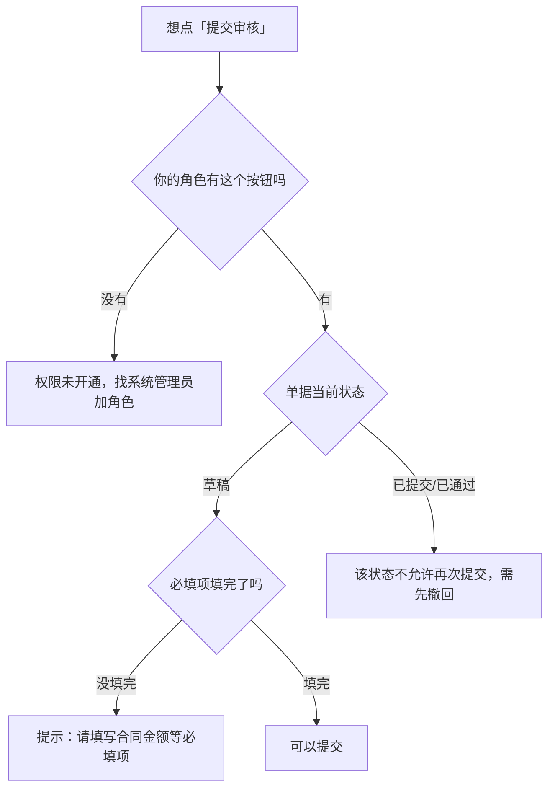

# 两仓逆向知识库 · 总体方案

> **一句话**：拿到一个 Java/Spring Boot 后端仓 + 一个 Vue 前端仓（合计 30 万行以上），不读代码、不靠人讲，反向生成一套**最终用户能看懂**的知识库——每页功能怎么做、完整流程图怎么走、哪里被限制、为什么被限制。
>
> **读者**：最终用户（主）、客服/实施、新接手的人（次）。
>
> **硬约束**：后端本地跑不起来；前端能跑并代理访问 SIT；仓库 30 万行以上；可调用外部大模型 API。
>
> **落点**：本目录 `02 Projects/两仓逆向知识库/`。本文是方案，`用户手册/` 是 P5 生成物的最终位置，`_tools/` 放管线脚本。

---

## 0. 五个结论，先看这里

1. **产物是用户手册，不是开发架构文档**。伪读者会让整个项目跑偏：用户只关心"这页干什么、我该怎么点、为什么点不了"，不关心你用了几层 Service。
2. **两仓的交汇点是接口契约，但用户手册的索引是「界面上那句话」**。所以要建的核心资产是**文案字典**（每句提示语/字段 label ↔ 触发它的代码条件），不是调用图。
3. **后端跑不起来不是阻塞**。静态抽取能拿 80%~90% 的契约与校验规则，剩下的用 SIT 真实流量补。本项目里后端只当**「限制的解释源」**，不重建全量业务逻辑。
4. **"限制"散在五层**：菜单/路由、字段、按钮、表单提交、接口拒绝。必须双侧抽——前端只是"提示"，后端才是"真拒绝"；用户两个高频困惑恰是"按钮能点但一提交就报错"和"按钮灰了不知道为什么"。
5. **"为什么"分三档**：机制（代码可证）／推断（有旁证）／待业务确认。第三档**绝不编**，汇成问题清单交给业务方。这是全项目唯一不能交给模型自由发挥的地方。

> [!note] 与 v1 的差异
> v1 面向开发重建立务知识。目标改为"给最终用户看"后：主战场从前端转向**前端 + SIT 真实页面**；范围从"全仓业务逻辑"缩到**菜单树能触达的页面/按钮/表单**；数据字典降级为"字段在界面上叫什么、能填什么"；管线由「代码解析→建图→契约对齐→业务聚合→生成→校验」改为按导航切片的六步（见 §3）。

---

## 1. 目标与边界

### 1.1 产出目标

用户拿到这套知识库，要能独立回答四个问题：

| # | 用户的问题 | 对应产物 |
|---|---|---|
| 1 | 这套系统能帮我做哪些事？ | 系统概览 + 角色任务流 |
| 2 | 我要办这件事，具体怎么点？ | 功能手册（一页一篇）+ 流程图 |
| 3 | 我这单子现在走到哪一步了？ | 单据状态机 |
| 4 | 这个按钮为什么点不了 / 这字段为什么不能改？ | 交互限制决策树 + 限制总表 + 错误提示字典 |

### 1.2 明确不做（out of scope）

- 给开发看的架构图、模块依赖图、数据表 ER 图
- 后端内部逻辑（定时任务、对账、MQ 消费、缓存策略）——用户看不见，整块跳过
- 全量数据字典（只在用户能感知的字段上做）
- 代码级重构建议、技术债清单

范围一缩，30 万行就不再是问题：**要覆盖的是菜单树，不是代码树。**

### 1.3 适配假设

| 维度 | 现状 | 对方案的影响 |
|---|---|---|
| 后端 | Java / Spring Boot，本地跑不起来 | 静态抽取为主；不用运行时 OpenAPI；`@ApiOperation` 等注解当"人工真相"交叉验证 |
| 前端 | Vue，本地能跑，可代理 SIT | 路由/API/文案静态抽取 + Playwright 走查双保险 |
| 仓库规模 | 两个仓合计 30 万行以上 | 按一级菜单切片，一页/一域一簇笔记，增量跑；不整仓喂模型 |
| 事实源 | 无 Swagger、无 DDL、无本地可跑后端 | 契约以 **SIT 真实流量**为准，源码为辅；数据字段靠 mapper/实体推断并标置信度 |
| 模型 | 可调外部 API（DeepSeek/千问/Claude 等） | 每页 5k tokens 级别小调用；全量首跑十几到几十元 |
| 环境 | Node 24 / Python 3.11 / JDK / git / uv / pnpm 已就绪 | 无需 Docker；SQLite + 脚本即可 |

---

## 2. 产物结构

### 2.1 目录

```
02 Projects/两仓逆向知识库/
├── README.md                  ← 本文（方案）
├── 用户手册/                    ← 最终交付物（对外）
│   ├── 00 系统概览.md
│   ├── 10 角色任务流/
│   │   ├── 业务员.md
│   │   ├── 审批人.md
│   │   └── 管理员.md
│   ├── 20 功能手册/
│   │   └── <一级菜单>/<功能页>.md
│   ├── 30 交互限制/
│   │   ├── 限制总表.md
│   │   ├── 状态流转.md
│   │   └── 错误提示字典.md
│   ├── 40 常见问题与找人.md
│   └── 90 内部附录/            ← 不对外：源码锚点、采集版本、待确认清单
└── _tools/                    ← 管线脚本
```

### 2.2 每篇功能手册的固定骨架

1. **这页是干什么的**（一句话，用人话）
2. **入口在哪**（菜单路径 / 从哪个页面进入）
3. **操作步骤**（编号步骤，配截图）
4. **字段输入要求**表：字段名 | 是否必填 | 格式/长度/范围 | 填错会怎样
5. **按钮可用条件**：按钮 | 什么状态下能点 | 什么角色能点 | 点击后的后果/二次确认
6. **常见问题**（把错误提示字典里跟本页相关的条目挂过来）
7. `[推断]` / `[待确认]` 标记（见 §2.5）

正文里**不出现任何技术名词**（类名、表名、接口路径、框架名）。

### 2.3 三类流程图（不要混成一张）

| 图 | 回答什么问题 | 数据来源 | 画法 |
|---|---|---|---|
| **角色任务流** | 我这个角色从进系统到办完一件事，点哪几步？ | 菜单/路由 + SIT 走查真实跳转 | Mermaid `flowchart LR`，一角色一张 |
| **单据状态机** | 单子卡在哪？下一步谁能动它？ | 状态枚举 + 状态变更校验分支 + 审批配置 | Mermaid `stateDiagram-v2`，一单据类型一张 |
| **交互限制决策树** | 按钮为什么灰 / 字段为什么不能改？ | 前端 disabled/visible 条件 + 权限 + 后端校验 | Mermaid `flowchart TD`，回答"为什么" |

决策树示例：



> 主用 Mermaid（纯文本、可 diff、可自动生成）；只挑 5~10 张核心流程图用 Excalidraw 美化。

### 2.4 限制总表的列定义（全项目最核心的一张表）

| 列 | 说明 | 例 |
|---|---|---|
| 对象 | 字段 / 按钮 / 菜单 / 整页 | 「合同金额」输入框 |
| 位置 | 所属页面 | 合同管理 / 新建合同 |
| 限制类型 | 不可见 / 只读 / 禁用 / 校验拦截 / 提交拒绝 | 只读 |
| 触发条件 | 判定条件（人话） | 合同状态 ≠ 草稿 |
| 用户看到什么 | 界面上实际呈现 | 输入框灰显，无提示语 |
| 违反后果 | 硬来会怎样 | 接口返回 `4001 当前状态不可修改` |
| 限制层 | 界面 / 服务端 / 两者都有 | 两者都有 |
| **原因** | 业务缘由，**必须带置信度** | 已进入审批，金额口径锁定 `[推断]` |
| 置信度 | 机制 / 推断 / 待确认 | 推断 |
| 证据 | 源码锚点或流量样本 | `frontend@d4e5f · ContractForm.vue:118` |

### 2.5 「为什么」的三档置信度（质量红线）

| 档位 | 含义 | 写法 | 处理 |
|---|---|---|---|
| **机制** | 代码可直接证明：因为状态=已提交，所以不可编辑 | 正常正文 | 自动生成，可发布 |
| **推断** | 有旁证：枚举命名、代码注释、git 提交信息、关联需求号 | 正文 + `[推断]` | 自动生成但标黄，人工抽检 |
| **待确认** | 监管/合同/客户定制约定，代码里没有 | **不进正文**，进「待业务方确认问题清单」 | 必须问人，确认后回填 |

> [!warning] 红线
> 不允许模型"补全"第三档。用户会照着错误理由去操作，这比手册里少写一条严重得多。校验脚本要硬性禁止 `[待确认]` 级别的结论出现在对外正文里。

### 2.6 frontmatter 约定

```yaml
---
title: 新建合同
type: manual-page
domain: 合同管理
audience: 业务员
collected: 2026-11-20        # 采集版本日期
roles: [业务员, 合同管理员]
confidence: 机制              # 该篇最高置信度
anchor: frontend@d4e5f/backend@a1b2c3d
---
```

`dataview` 用 `type` + `domain` + `collected` 就能在首页出「按域进度 + 采集日期是否过期」。

---

## 3. 六步管线

每步都写明：输入 → 做什么 → 输出 → 人工介入点。**P2/P3 之外都能无人值守跑。**

### P1 盘点与切片

- **输入**：两仓代码
- **做什么**：统计规模（cloc）；抽前端路由树与菜单结构；抽角色定义（路由 `meta.roles`、菜单接口、后端权限注解）；按一级菜单切出 40~60 个切片
- **输出**：页面清单、角色 × 菜单矩阵、切片表
- **人工**：确认切片划分是否与业务域对上（半小时足够）
- **成本**：0（不用模型）

### P2 静态抽取

- **输入**：两仓源码
- **做什么**：
  - 前端（ts-morph + `@vue/compiler-sfc`）：路由、`api/*.ts` 调用点、`constants`/`dict`/`enums`、**全量文案字典**（label/按钮/placeholder/提示语/i18n key）、控件状态条件（`v-if`/`v-permission`/`:disabled`）、表单校验规则
  - 后端（Spoon，走仓里的 `mvnw`/`gradlew`）**只抽四类**：参数校验注解、状态枚举与状态变更校验分支、权限注解与数据权限拦截、错误码/异常消息
- **输出**：SQLite 事实库（表结构见 §4.2）
- **人工**：处理路由常量拼接等疑难；抽检 20 条文案的准确性
- **成本**：0

### P3 运行时补真

- **输入**：SIT 环境 + 各角色测试账号
- **做什么**：Playwright 按角色遍历全部路由，采集：全页截图、DOM 快照、该页发出的 xhr/fetch（URL/method/请求样本/响应结构/错误码）、控件可见与禁用状态
- **输出**：`traffic_sample`、`screenshot` 表；补齐真实网关前缀与实际报错文案
- **人工**：⚠️ 测试账号、**跳过所有写操作按钮**、截图脱敏；每角色跑一遍
- **成本**：走查 1~2 小时/角色
- **降级**：拿不到多角色账号 → 只跑一个角色，权限限制改用静态抽取 + 业务方确认

### P4 事实对齐

- **输入**：P2 + P3
- **做什么**：三向对齐「前端调用点 ↔ 静态抽出的后端接口 ↔ SIT 观察到的真实接口」；对齐「界面文案 ↔ 触发它的条件 ↔ 后端校验」；生成限制总表初稿与状态机素材
- **输出**：限制总表、状态机骨架、三向差集报告（死接口 / 内部接口 / 只被定时触发的接口）
- **人工**：审差集报告（差集本身就是高价值知识）
- **成本**：0

### P5 生成与校验

- **输入**：切片 + 对齐后的事实
- **做什么**：按页/按域喂"骨架 + 证据片段"，LLM 按 §2.2 模板生成；同时生成三类 Mermaid 图；跑锚点校验（每条断言回查源码行）与一致性校验（提到的接口必须在该切片集合内）；标注三档置信度
- **输出**：`用户手册/` 全量笔记
- **人工**：抽检 10 篇；把 `[待确认]` 汇成问题清单发业务方
- **成本**：每页约 5k tokens；全量首跑十几到几十元，增量几元

### P6 增量维护

- **输入**：两仓 git diff + 采集版本
- **做什么**：diff → 命中受影响页面/切片 → 只重跑相关切片；文案哈希变化触发该页重生成；截图允许滞后但必须更新 `collected`；锚点失效的断言自动标红
- **输出**：更新后的手册 + 过期清单
- **人工**：每轮抽检变更页
- **成本**：单页 < 5 分钟

---

## 4. 技术选型

### 4.1 选型表

| 层 | 选型 | 理由 | 不选什么 |
|---|---|---|---|
| 后端抽取 | **Spoon**（`fr.inria.gforge.spoon:spoon-core`，`mvnw` 跑子进程，输出 JSON） | 有类型解析，注解/继承/调用链比纯文本稳 | 不自己写 Java 正则解析；JDK 过新时用 JavaParser + JavaSymbolSolver 兜底 |
| 前端抽取 | **ts-morph** + `@vue/compiler-sfc` | Node 24 已装；TS 类型与路由/文案一把抽完 | 不上 ESLint AST 魔改 |
| 运行时采集 | **Playwright**（Python）+ `storageState` | 截图/DOM/XHR 一次拿全，多角色做差集 | 不手工点 |
| 事实库 | **SQLite**（单文件） | 30 万行也就几万节点；零运维、可进 git 旁的 `_tools/` | Neo4j / Docker |
| 生成 | **DeepSeek / 千问**（OpenAI 兼容 + JSON Schema 强约束） | 便宜、长上下文、支持 prompt caching | 不上 LangChain / LlamaIndex 的 Agent 全家桶（这是确定性管线） |
| 图 | **Mermaid**（主）+ Excalidraw（精选美化） | 纯文本、可 diff、可自动生成；Obsidian 原生支持 | 不做手工拖拽图（无法维护） |
| 展示 | 本库 Obsidian + Dataview + Tasks | 零成本，已有插件 | 不另建站点 |
| 增量 | git diff + content hash 缓存（SQLite 表） | 省钱、省时间 | 不做全量重跑 |

### 4.2 事实库表结构（初稿）

```sql
-- 导航与页面
route(id, path, name, title, meta_json, role_required, parent_id, source_file, source_line)
menu(id, name, path, parent_id, role_set, source)

-- 前端抽取
api_call_site(id, file, line, fn_name, url, method, params_schema)
ui_text(id, file, line, kind, text, i18n_key, context)   -- kind: label|button|placeholder|message|title|tab
ui_control(id, route_id, kind, label, ctrl_type, required, disabled_cond, visible_cond, perm_cond)
validation_rule(id, source, target, rule_type, expr, message)  -- source: frontend|backend

-- 后端抽取
endpoint(id, http_method, url_template, controller_class, method_name, module, source_line)
param_rule(id, endpoint_id, name, required, type, constraint, message)
state_machine(id, entity, enum_class, source_file)
state_transition(id, sm_id, from_state, to_state, trigger, guard_condition, source_line)
permission_rule(id, kind, annotation, expr, source_line)
error_code(id, code, message, user_action, source_file, line)

-- 运行时
traffic_sample(id, route_id, role, url, method, req_sample, resp_schema, status, captured_at)
screenshot(id, route_id, role, path, captured_at)

-- 知识与校验
doc(id, path, kind, domain, collected, updated_at)
anchor(id, doc_id, repo, commit, path, line_start, line_end, claim)
llm_cache(key_hash, model, prompt_hash, output_json, created_at)
```

### 4.3 LLM 用法

- **按切片调用**，一次一页或一域，上下文里只放：该页路由与控件、相关 api 调用点、相关后端校验、traffic 样本、同域已生成笔记摘要
- **输出 JSON Schema 强约束**：每篇必须返回 `sections[]` + `evidence[]`（锚点）+ `confidence`
- 提示词里明确：不知道就标 `[待确认]`，禁止编造业务原因
- 用 prompt caching 缓存系统提示词与模板

### 4.4 证据锚点格式

```
[backend@a1b2c3d · ContractController.java:42-58]
[frontend@d4e5f · ContractForm.vue:118]
[traffic · 2026-11-20 · POST /api/contract/submit · 4001]
```

校验脚本只做两件事：锚点文件是否存在、行号区间是否仍落在预期内容附近。

---

## 5. 一周节奏

| 天 | 任务 | 产出 | 依赖 |
|---|---|---|---|
| **D1** | P1 + P2 前端部分：路由树、角色×菜单矩阵、文案字典 | 页面清单、切片表、文案表 | 两仓路径 |
| **D2** | P3：多角色 SIT 走查、截图、XHR | traffic + screenshot 表 | SIT 账号 × 角色 |
| **D3** | P2 后端四类 + P4 三向对齐 | 限制总表初稿、状态机骨架、差集报告 | 后端能编译（跑 `mvnw` 即可，不需启动） |
| **D4** | P5 跑 3 个最核心功能（功能手册 + 三类图） | 3 篇样板笔记 | D1~D3 |
| **D5** | 业务方评审样板；发「待确认问题清单」 | 修订后的模板与口径 | 业务方对接人 |
| **D6** | 按一级菜单横铺（分批跑） | 用户手册全量初稿 | 样板确认 |
| **D7** | 锚点校验、抽检、接增量脚本 | 可交付版本 + 重跑命令 | — |

> 关键路径是 **D2（SIT 账号）× D5（业务方评审）**，这两个不等人。D2 拿不到多角色账号就走降级路径，不阻塞 D3。

---

## 6. 验收标准

### 6.1 用户视角（主）

1. **一个从没用过系统的同事，只看手册能独立完成一个核心任务，全程不问人。**
2. **任一"按钮点不了 / 字段不能改"，能在 30 秒内查到：原因 + 该找谁 + 怎么解开。**
3. **3 张核心流程图，业务方看过点头**（走法没错、没有漏掉关键分支）。
4. **库里能搜到界面上的原话**：用户拿着屏幕上那句提示语来搜，能命中对应解释。

### 6.2 工程视角（次）

5. 证据锚点抽检 ≥ 95% 行号准确，100% 可解析。
6. 一键重跑全量，无需手改脚本；增量单页 < 5 分钟。
7. `[待确认]` 结论 100% 不出现在对外正文里。

### 6.3 红灯（出现任意一条即不通过）

- 手册里存在无法回查源码的断言
- 业务原因（第三档）由模型编造而非人确认
- 截图与当前版本不符且未更新 `collected`
- 同一页面在不同角色手册里描述矛盾

---

## 7. 风险与对策

| 风险 | 概率 | 对策 |
|---|---|---|
| 版本漂移，手册快速过期 | 高 | 增量重跑 + `collected` 版本戳 + 过期清单；优先保文案与限制表 |
| 角色覆盖不全，权限限制说不清 | 高 | 每角色一份走查，diff 出差异；拿不到就降级为源码推断 + 标 `[推断]` |
| 后端跑不起来导致限制解释不全 | 中 | 用 SIT 响应错误码反推 + 业务方问题清单补齐 |
| 模型编造业务原因 | 中 | 三档置信度 + 校验脚本硬拦 + 抽检 |
| 走查误触写操作 | 中 | 测试账号 + 按钮白名单 + 只读巡检 |
| 30 万行拖垮成本 | 低 | 按菜单切片、单页 5k tokens、缓存 |
| 截图/配置泄露敏感信息 | 中 | 脱敏后再入库；内网地址与密钥不进用户手册 |

---

## 8. 前置事项（按 ROI 排）

| 优先级 | 事项 | 影响 |
|---|---|---|
| P0 | 两仓本地路径 | 一切的前提 |
| P0 | **多角色测试账号 + SIT 登录态** | 决定 D2 能否自动走查，是权限限制清单的唯一来源 |
| P1 | SIT 库「仅表结构」导出（`mysqldump --no-data`，不含数据） | 用户可见字段的含义从「推断」升级为「事实」 |
| P1 | 业务方对接人 1 名 | 「为什么」第三档的唯一出口 |
| P2 | 后端仓能否用 `mvnw` 编译通过 | 决定 Spoon 走源码还是走 class 文件 |

---

## 9. 下一步

1. 提供两仓路径与 SIT 账号 → 跑 D1（路由树 + 角色×菜单矩阵 + 文案字典），当天出结果、不用模型。
2. 有样板后，用 3 个核心功能验证模板，再横铺。
3. 手册稳定后，可顺手把事实库包成一个 MCP 查询服务，让 AI 也能回答"这按钮为什么灰"——属可选项，不影响主交付。
