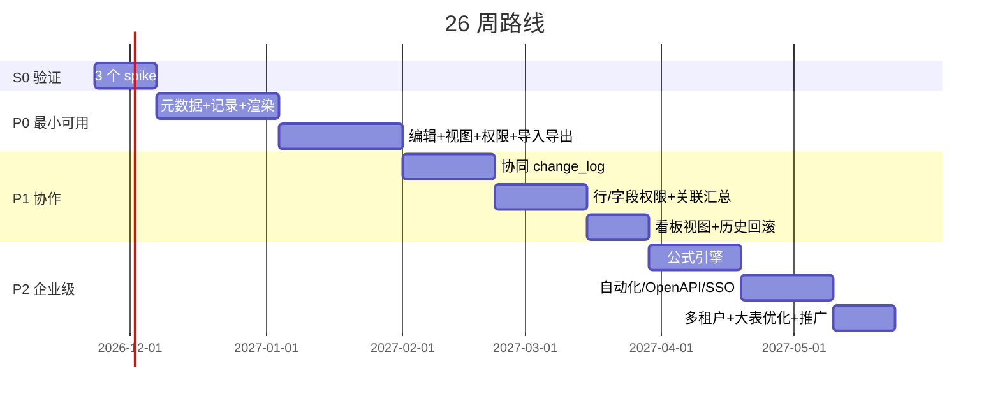

# 04 从零落地路线（26 周，逐周可验收）

> 这篇回答「**明天开始做什么**」。假设你有一个 4~6 人的小队，目标是 26 周做出内部可推的系统。
>
> 核心原则：
> 1. **先做垂直切片，再横向铺开**。任何功能都必须贯穿"数据库 → API → 前端渲染 → 编辑 → 刷新还在"整条链路，否则做出来的只是图层。
> 2. **每周都有可演示的东西**。做不出可演示的东西，说明上周拆错了。
> 3. **技术验证不过就不要开工**。S0 的 2 周能省掉后面 2 个月。

---

## 1. 总览

| 阶段 | 周 | 主题 | 一句话验收 |
|---|---|---|---|
| **S0** | W1~W2 | 技术验证 | 三个 spike 达标，技术路线定稿 |
| **P0** | W3~W10 | 最小可用 | 10 人内测一张真实业务表，数据能进来、能改、能导出 |
| **P1** | W11~W18 | 协作与权限 | 200 人试点，实时协同不丢数据，行/列级权限生效 |
| **P2** | W19~W26 | 企业级 | 公式/自动化/SSO/多租户上线，全公司推广 |



---

## 2. S0：技术验证（2 周，Go / No-Go）

不要写业务代码，只写丢弃式验证。三个 spike 并行，每个 2~3 天。

### Spike A：VTable 渲染与编辑

- 造 30 万行假数据，每页 200 行，从 mock API 拉。
- 验证：① 200 行 × 30 列首屏 < 1 s；② 滚动 fps ≥ 50；③ 自定义单元格（彩色标签 + 头像）10 列不卡；④ 双击编辑 → 提交 → 刷新还在；⑤ 1000 行 × 30 列时的内存占用。
- **不过关的降级**：减少单页行数、关掉 `customLayout` 换 `fieldFormat`、把部分列改为只读。

### Spike B：PostgreSQL JSONB 查询

- `generate_series` 造 100 万条记录（每条 20 个字段），跑 5 组真实筛选组合（等值 / 范围 / 多选包含 / 三条件 and / 筛选+排序）。
- 验证：P95 < 500 ms；`EXPLAIN (ANALYZE, BUFFERS)` 走索引而非全表；GIN 索引体积与写入延迟可接受。
- **不过关的降级**：加表达式索引 → 加 STORED 生成列 → 上值列存（`record_cell`）→ 分区。

### Spike C：协同链路

- Spring WebSocket + Redis Pub/Sub，两个浏览器标签页改同一格。
- 验证：① 对方 200 ms 内看到；② 同时改产生 409 且界面能选"保留我的"；③ 断网 30 s 后重连能补齐增量。
- **不过关的降级**：先用轮询兜底，把协同挪到 P1（但 change_log 表结构必须先设计好，否则返工）。

### S0 交付物

- 三个 spike 的代码 + 实测数据表（不是"感觉还行"）；
- 一页纸的技术决策记录（ADR）：存储方案、分页方案、协同方案、权限方案；
- 明确的"不做清单"：移动端、离线编辑、字符级协同、AI 字段（都写进 P3/不做）。

---

## 3. P0：最小可用（8 周）

### W1：骨架 + 元数据

- 仓库初始化：Maven 多模块（`mdt-common / metadata / query / record / bootstrap`）、前端 Vite + React + TS、`docker-compose` 起 PG/Redis/MinIO。
- Flyway `V1__init.sql`：`space / datasheet / field / view / record`（见 01 文档 DDL）。
- 元数据 API：建空间、建表、加字段、改字段、删字段（软删）。
- 前端：一个页面能建表 + 列出字段（此时表格可以是假的）。

**DoD**：用 curl 建出"任务表 + 5 个字段"，刷新页面还在。

### W2：记录 + 查询编译 + 渲染

- 记录 CRUD（单条 + 批量）、雪花 ID、`rank` 分数索引。
- 查询编译器第一版：`eq / ne / gt / lt / in / contains / isEmpty` + 多字段排序 + keyset 分页。
- 前端 `RecordStore` + `setRecords` + 分页器；列定义由元数据生成（先支持 5 种类型）。

**DoD**：1000 条假数据，能筛选、排序、翻页，表格列标题来自数据库。

### W3：编辑链路

- `PATCH /records/{id}`（`opId` + `baseVersion` + 多字段 op）→ `jsonb_set` 原子更新。
- 前端：`change_cell_value` → 乐观更新 → 提交 → 失败回滚；409 弹冲突对话框。
- 字段类型补齐到 10 种：文本/多行/数字/日期/复选框/单选/多选/成员/日期时间/评分（含各自编辑器与 `validateValue`）。

**DoD**：两个人同时编辑不丢数据；断网一次后重试成功且不重复写入。

### W4：视图配置 + 自定义渲染

- 视图 CRUD、默认视图、筛选/排序/分组/隐藏字段持久化（`view.config`）。
- 列宽拖拽、行高、冻结列数保存到视图（debounce 800 ms）。
- `customLayout` 渲染：单选彩色标签、多选、成员头像、评分星、只读公式样式。

**DoD**：改完视图配置，换个人打开看到一样的表格。

### W5：权限 + 审计

- 空间角色（owner/admin/editor/commenter/viewer）、表级 read/write、只读分享链接（token + 过期）。
- 所有查询入口共用一个 `PermissionService`（REST、导出、WebSocket 订阅）；DTO 组装时做字段裁剪。
- `audit_log` + 异步写入：登录、建表、改权限、导出、删除。

**DoD**：只读用户看不到编辑按钮也调不动 PATCH；越权测试用例全绿。

### W6：导入导出 + 回收站

- CSV/XLSX 导入：字段映射预览、类型校验、错误行报告、大文件走后台任务（进度轮询）。
- 导出 CSV（UTF-8 BOM）/ XLSX；导出走同一查询编译器，含权限过滤。
- 回收站：软删 + 恢复 + 彻底删除（审计记录）。

**DoD**：导入 10 万行 CSV（故意混 50 条脏数据）能给出逐行错误并成功导入其余。

### W7：压测与优化

- JMeter/k6 脚本：列表查询 50 QPS、编辑 20 QPS、导出 1 次/分钟，持续 30 分钟。
- `pg_stat_statements` 找 TOP 慢查询，逐个加索引/改 SQL；前端 Lighthouse + 长任务分析。
- 埋点：接口 P95/P99、慢查询、前端错误上报。

**DoD**：压测指标达到 README §9 目标的 80%，无内存泄漏。

### W8：内测与收尾

- 找 10 个真实用户，导入 1~2 张真实业务表（比如"招聘进度""供应商清单"），跑一周。
- 修 P0 阻断性 bug；补文档（用户手册 3 页 + 管理员手册 2 页）；上线演练（备份/恢复/回滚）。
- **P0 复盘**：哪些需求是伪需求？哪些设计要返工？把结论写进 ADR。

---

## 4. P1：协作与权限（8 周）

| 周 | 内容 | 关键产出 |
|---|---|---|
| W11~W13 | `change_log` + `seq` + 幂等 `opId`；WebSocket 房间与鉴权；断线 `sinceSeq` 重放；presence | 两个标签页实时同步；断网重连补齐 |
| W14~W15 | 行级权限（`row_filter` DSL 注入）、字段级权限（禁读/禁写，含导出裁剪）、权限缓存与失效 | 同一张表不同人看到不同行/列 |
| W16~W17 | 关联字段 + 查找 + 汇总（物化 + 变更触发重算）、唯一性校验 | 跨表关联可用，汇总值秒级更新 |
| W18 | 看板视图（按单选分组拖拽）、单元格历史、整表快照回滚 | 200 人试点，反馈清单 |

**P1 的最大风险**：协同与编辑链路的耦合。务必先定好 `op_id`/`seq`/`version` 三个字段的语义，再写代码——这三个字段设计错，P2 要推倒重来。

---

## 5. P2：企业级（8 周）

| 周 | 内容 | 关键产出 |
|---|---|---|
| W19~W21 | 公式引擎：Pratt 解析、类型检查、依赖图、增量重算、30+ 高频函数、循环引用报错 | 公式字段可用，错误可定位到字符位置 |
| W22~W23 | 自动化（触发器 + 动作：改字段/发通知/调 Webhook）、OpenAPI 生成、API token | 外部系统能通过 API 写入并触发自动化 |
| W24 | SSO（OIDC / 企业微信 / 飞书）、多租户隔离、水印 | 接入公司账号体系 |
| W25 | 仪表盘（图表基于聚合接口）、千万行优化（值列存/分区/只读副本）、监控告警 | 单表 500 万行可查询 |
| W26 | 推广：模板、培训、迁移工具、SLA 与值班 | 全公司上线 |

---

## 6. 第 1~3 天就能动手的骨架

### 6.1 后端骨架（关键依赖）

```xml
<!-- Spring Boot 4.1.x BOM 管版本；以下只列非 obvious 的 -->
<dependency><groupId>org.jooq</groupId><artifactId>jooq</artifactId></dependency>
<dependency><groupId>org.flywaydb</groupId><artifactId>flyway-core</artifactId></dependency>
<dependency><groupId>org.flywaydb</groupId><artifactId>flyway-database-postgresql</artifactId></dependency>
<dependency><groupId>org.springframework.boot</groupId><artifactId>spring-boot-starter-websocket</artifactId></dependency>
<dependency><groupId>org.springframework.boot</groupId><artifactId>spring-boot-starter-data-redis</artifactId></dependency>
<dependency><groupId>org.springframework.boot</groupId><artifactId>spring-boot-starter-oauth2-resource-server</artifactId></dependency>
<dependency><groupId>cn.idev.excel</groupId><artifactId>fastexcel</artifactId><version>1.3.0</version></dependency>
<dependency><groupId>org.springframework.boot</groupId><artifactId>spring-boot-starter-actuator</artifactId></dependency>
```

### 6.2 最小 API 契约（先定契约再写实现）

```http
GET  /api/v1/datasheets/{dsId}/views/{viewId}/records?limit=200&cursor=
     → 200 { columns:[...], records:[{id, version, data:{}}], nextCursor, totalHint }

PATCH /api/v1/datasheets/{dsId}/records/{recordId}
     body { baseVersion: 12, ops: [{ opId:"uuid", fieldId:"f_1001", value:"x" }] }
     → 200 { version: 13, applied:["uuid"] }
     → 409 { code:"CELL_CONFLICT", fieldId, yourValue, currentValue, currentVersion, changedBy }

GET  /api/v1/datasheets/{dsId}/changes?sinceSeq=1024       → 200 { seq: 1030, ops:[...] }
WS   /ws  (STOMP)  SUBSCRIBE /topic/datasheets/{dsId}
POST /api/v1/datasheets/{dsId}/imports                     → 202 { taskId }
```

### 6.3 前端组件树

```
<App>
 └─ <DataSheetPage datasheetId viewId>
     ├─ <ViewToolbar/>        筛选/排序/分组/字段配置/分享
     ├─ <DataSheetTable/>     ← 唯一引 VTable 的地方
     │   └─ <VTable.ListTable columns records onReady/>
     ├─ <RecordDrawer/>       行详情 + 评论 + 历史
     └─ <ConflictDialog/>     409 冲突处置
```

`DataSheetTable` 的 props 只有三个：`columns`、`records`、`callbacks`。**VTable 实例不允许出现在这个组件之外**，否则数据层会被渲染细节污染。

---

## 7. 测试策略

| 层 | 工具 | 必测内容 |
|---|---|---|
| 单元 | JUnit 5 + AssertJ | DSL→SQL 编译（含 NULL/类型转换/布尔嵌套）、公式求值、权限矩阵、分数索引 |
| 集成 | Testcontainers（真 PG） | 事务/`jsonb_set`/并发冲突/权限注入后的 SQL 正确性 |
| 契约 | OpenAPI + 前端 type 生成 | 前后端字段名/可空性一致；契约变更必须过 CI |
| E2E | Playwright | 建表 → 加字段 → 录入 → 筛选 → 编辑 → 导出 六步；越权用例 |
| 性能 | k6 / JMeter | 列表 50 QPS、编辑 20 QPS、导出；每次发版跑 30 分钟 |
| 安全 | 手工 + 自动化 | 越权（改 URL、构造 body）、SQL 注入（筛选 DSL）、附件预签名越权、XSS（自定义单元格渲染） |

**必测的 8 个越权用例**（写成 CI 里的固定测试）：无权限读表 / 无权限写表 / 只读用户走导出 / 字段级禁读用户看列表与详情 / 分享链接过期后访问 / API token 跨表 / WebSocket 订阅未授权表 / 行级权限用户通过筛选条件反推（`count` 信息泄露）。

---

## 8. 团队分工与协作规范

| 角色 | 人数 | 负责 |
|---|---|---|
| 架构 / 全栈 | 1 | 技术决策、跨模块难点（查询编译、协同）、Code Review |
| 后端 | 2 | 元数据+记录（1）、查询+公式+权限（1） |
| 前端 | 1.5 | VTable 集成与自定义单元格、视图交互、数据层 |
| QA | 1 | 测试用例、性能压测、越权专项 |
| PM / 设计 | 0.5 | 需求排序、用户内测、文档 |

工程规范（不多但必须执行）：
- **DB 变更只走 Flyway**，禁止手改生产库；每个迁移脚本必须可重复执行（幂等）。
- **所有查询必须经过 `mdt-query`**，Code Review 看到手写 SQL 直接打回（权限和筛选才有唯一入口）。
- **契约优先**：先改 OpenAPI，再改前后端，CI 校验 breaking change。
- **每个 PR 带测试**；查询编译器/权限/公式三个模块要求覆盖率高（≥ 80%）。
- 灰度开关：`datasheet.storage_mode`、`feature.collab_enabled` 这类开关按表/按空间灰度，出问题能退。

---

## 9. 上线检查单

- [ ] 备份：每日全量 + WAL 归档，**恢复演练做过至少一次**
- [ ] 回滚：应用版本可回退，DB 迁移有 down 方案（或明确只前进 + 兼容窗口）
- [ ] 监控：接口 P95、错误率、慢查询 TOP10、WS 连接数、Redis 内存、磁盘
- [ ] 告警：错误率 > 1%、P95 > 1s、磁盘 > 80%、WS 掉线率 > 5%（值班人）
- [ ] 限流：登录、导出、导入、API token 分别限流；大查询 `statement_timeout`
- [ ] 审计：登录/导出/权限变更/删除 四类事件已落库且可查
- [ ] 权限：8 个越权用例在生产配置下复测（不是只在测试环境跑）
- [ ] 数据：初始模板、示例空间、管理员账号、导入指引
- [ ] 出口：SSO 对接完成，员工离职自动失效（靠 IdP 同步，不靠手动删号）
- [ ] 容量：按 3 个月数据增长预估磁盘，提前扩容计划
- [ ] 合规：审计保留 ≥ 6 个月、隐私字段脱敏、附件访问留痕
- [ ] 文档：用户手册、管理员手册、API 文档、应急预案（含"数据库挂了怎么降级为只读"）

---

## 10. 成本估算（内部参考，非报价）

| 项 | 估算 |
|---|---|
| 人力 | 5.5 人 × 6 个月 ≈ **33 人月**（P0 结束约 15 人月） |
| 开发环境 | 2 台 8C16G（应用+DB）+ 1 台 4C8G（前端/CI） |
| 生产（200 人） | 应用 2×4C8G、PG 1×8C32G + 200 GB SSD、Redis 1×2C4G、MinIO 1 TB、备份存储 |
| 隐性成本 | 数据迁移（Excel 模板统一）、培训、试点部门沟通、后续值班 |

> 经验值：**P0 的 8 周里，大约 40% 的时间会花在"用户说这不是我们要的"上面**。预留缓冲，别把排期排满。

---

## 11. 从零最容易踩的 10 个坑

1. **先做 UI 再做数据模型**：视图配置散落在前端 state 里，两周后全部返工。
2. **把 VTable 当数据网格**：直接 `records` 塞 10 万行，浏览器内存爆炸，编辑卡死。
3. **动态字段用 EAV 起步**：写到第 30 个字段时发现每个列表查询都是 15 个 join。
4. **权限只做前端隐藏**：一次导出就把数据全带走。
5. **协同和编辑同时开工**：两个未定型的链路互相阻塞，建议 P0 先单机编辑，P1 再协同。
6. **公式引擎先做通用表达式**：用户要的是 `ROUND(SUM({金额}), 2)`，不是"能算 1+1"。
7. **忽略导入**：真实用户第一件事就是把手里的 Excel 导进来。导入体验决定第一印象。
8. **没有"不做清单"**：每加一个视图类型/字段类型，测试矩阵就翻倍。
9. **性能优化靠感觉**：不上 `pg_stat_statements` 和压测，永远在猜。
10. **不做灰度**：一次性全量上线，出问题只能回滚数据库。

---

## 相关

- [README 总体方案](README.md)
- [01 数据模型与存储引擎](01%20数据模型与存储引擎.md)
- [02 VTable 前端落地](02%20VTable%20前端落地.md)
- [03 协同、权限与审计](03%20协同、权限与审计.md)
