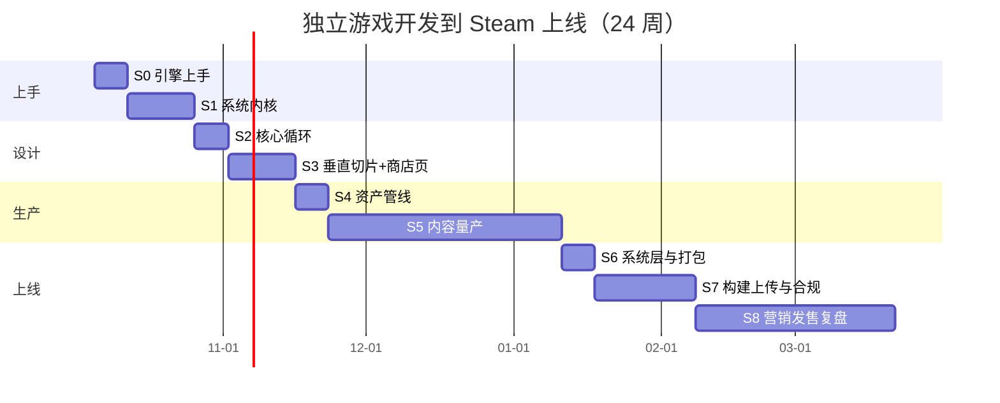

# 独立游戏开发到 Steam 上线（个人开发者落地版）

> 核心原则：**独立游戏不是技术问题，是"产品 + 完成度 + 营销"问题。**
> 90% 的项目不是死于不会写代码，而是死于：范围太大做不完、做完了没人知道、玩法不好玩却不敢砍。
> 所以这套计划的三条主线是顺序固定的：**先把范围砍到能做完 → 再用最短路径把技术学到够用 → 最后把流程完整走一遍。**

本计划与 [[01 Notes/框架与工具/游戏开发技术栈|游戏开发技术栈]] 配套：那篇讲"行业里有什么"，这篇只讲"**你一个人、每周 10~15 小时、第一款游戏**该怎么做"。

> [!warning] 一条贯穿全程的并行轨道（最容易漏）
> **Steam 商店页与 Next Fest 的日程，跟你的开发进度不是同一条时间线。**
> 商店页必须在 **W6（2026-11）公开**，Steamworks 账号与 $100 上架费也在那时交——因为 Next Fest 报名截止在 **W14（2027-01-10）**，而你那时游戏还没做完。
> 如果你只按"做完游戏 → 再上架"的顺序走，会直接错失唯一一次 Next Fest。

## 0. 先对齐现实（不看清这个，后面全是白干）

| 事实 | 含义 |
| --- | --- |
| 2025 年 Steam 上架约 **21,404** 款新游（2026 上半年 **12,122** 款）；其中约 **40%** 收入不足 **$100**、**65.9%** 不足 **$1,000**、仅 **8%** 超过 **$10 万**；**47.5%** 的作品销量不足 **100 份**（经验值，SteamDB/Gamalytic 口径） | **第一款游戏的目标不是爆款，是"完整走完一遍流程并且不亏"** |
| 收入 ≈ 愿望单 × 转化率 × 价格 × 分成；首周转化中位数约 **每 100 愿望单换 10–11 份**（经验值） | **营销不是发售前两周的事，是垂直切片做完那天就开始的事** |
| 玩家平均只会看你的商店页 10 秒、预告片 30 秒 | **前 30 秒的"爽感"需要专门做，不是做完游戏再剪** |
| 一个人做 3D、联机、长剧情 RPG 的成本是 2D 单机的 3~10 倍 | **第一款游戏必须是 2D、单机、短时长** |
| 每多一个系统，就要多一份 UI、存档、教程、本地化、测试、Bug | **功能数量是线性增加工作量，组合起来是平方级增加 Bug** |

**本计划的成功定义（第一款游戏）**：

- [ ] 在 Steam 上有一个能正常购买、下载、运行、退款率不爆的页面
- [ ] 玩家能在 15 分钟内自己搞懂怎么玩（无需你解释）
- [ ] 有 30~90 分钟真正好玩的体验；评价数够 **10 条**才显示评分，**目标 ≥20 条且好评率 ≥80%**
- [ ] 收回上架费与素材成本（哪怕只有几百美元）
- [ ] 留下第二个项目的资产：可复用的代码框架、素材、商店页经验、一小撮愿意买你下一款的玩家

> [!warning] 一句话劝退
> 如果你要的是"6 个月辞职做游戏、第一款就月入过万"，这套计划帮不了你——那是运气 + 多年积累的组合。这套计划帮你的是：**用 24 周（每周 10~15 小时）把第一款游戏真正上架，并建立可复制的第二款流程。**

## 1. 技术栈定选（一条主线，不做多选题）

**结论：Godot 4.7.x + GDScript（主推）；想少写代码的纯像素 2D 可换 GameMaker；只有要移植主机或重度依赖闭源 SDK 才选 Unity 6。**

| 层 | 选择 | 为什么 | 什么情况下换 |
| --- | --- | --- | --- |
| 引擎 | **Godot 4.7.x** | MIT 免费无分成、安装包 100MB 级、**独立 2D 渲染管线**、导出 Windows 一键完成 | 要移植主机（Godot 无官方主机端口，需买中间件）/ 重度依赖闭源 SDK → **Unity 6**；想少写代码、纯像素 2D → **GameMaker**（$99.99 一次性、无版税） |
| 语言 | **GDScript** | 与引擎贴得最紧，教程与文档一致，写玩法逻辑极快 | 已有 C# 基础且想复用 → Unity 或 Godot .NET 版 |
| 美术 | **Aseprite**（$19.99）或 **LibreSprite**（免费分支） | 像素风是小团队唯一能自己搞定的美术风格 | 做矢量/手绘 → Inkscape / Krita |
| 音频 | **Audacity**（剪辑）+ **jsfxr / Bosca Ceoil**（音效音乐）+ 免费素材库 | 音效对"手感"的贡献远大于你的想象，且便宜 | 预算允许 → 买素材包 |
| 版本控制 | **Git + Git LFS** | 美术二进制资源必须走 LFS，否则仓库爆炸 | 团队 > 5 人 → Perforce |
| 项目管理 | **本知识库**（GDD 用 Markdown + Obsidian 看板） | 你已经有这套基建，别再学新工具 | — |
| Steam 接入 | **GodotSteam**（已跟进 Godot 4.7.x）/ Steamworks.NET（Unity） | 成就、云存档、Rich Presence 接起来最省事 | — |

> 版本号、授权价格与政策（Unity 6 的 Runtime Fee 已取消、Personal 免费门槛 20 万美元、Unreal 的 5% 版税门槛等）都做了带来源的核查，见 [[2025-2026 独立游戏引擎与有趣度设计简报]]。

**明确不学的东西（第一款游戏期间）**：3D 管线、Shader 手写、服务器与联机、主机移植、自研引擎、Unreal C++、热更新。

> [!important] 选型铁律
> 选引擎只花 **2 天**：各装一遍，各跟一集官方入门教程做一个"角色能动 + 能撞东西"的场景，哪个更顺就用哪个，然后**三年内不再换**。
> 换引擎是独立开发者最大的时间黑洞，没有之一。

## 2. 学习路线总表（24 周 / 每周 10~15 小时）

```text
阶段一 上手（W1–W3）—— 先把"从想法到能玩"的循环跑通
  S0 引擎上手与最小可玩     装引擎，7 天做出一个 60 秒小游戏        [1 周]
  S1 游戏系统内核           输入/状态机/碰撞/相机/UI/数据驱动       [2 周]

阶段二 设计（W4–W6）—— 这一阶段决定游戏好不好玩，最容易被跳过
  S2 核心循环与有趣度设计   一个动词 + 一个幻想 + 30 秒爽感          [1 周]
  S3 垂直切片与竞品拆解     做出"最终品质的 5 分钟" + 开立 Steam 商店页 [2 周]

阶段三 生产（W7–W14）—— 最枯燥、死项目最多的一段
  S4 资产管线与美术音频     风格统一、授权干净、能批量产出           [1 周]
  S5 内容量产与打磨         关卡/数值/平衡/性能，把 5 分钟变成 90 分钟 [7 周]

阶段四 上线（W15–W24）—— 决定能不能赚到钱
  S6 系统层本地化与打包     存档/设置/键位/多语言/打包，上架硬门槛    [1 周]
  S7 Steam 构建上传与合规   构建审核、成就云存档、Demo（商店页已在 W6 开） [3 周]
  S8 营销发售与复盘         愿望单、预告片、Next Fest、定价、发售、复盘 [6 周]
```

### 排期表（可直接当周计划）

| 周 | 阶段 | 本周必须产出的东西 | 文档 |
| --- | --- | --- | --- |
| W1 | S0 | 一个能玩 60 秒的小游戏（可导出 exe 发给朋友） | [[S0 引擎上手与最小可玩]] |
| W2–W3 | S1 | 一个"能打、能死、能重开"的可玩原型 | [[S1 游戏系统内核]] |
| W4 | S2 | 一句话玩法陈述（6 个空）+ 30 秒爽感演示 + GDD v0.1 | [[S2 核心循环与有趣度设计]] |
| W5–W6 | S3 | 垂直切片（最终美术的 5 分钟）+ 5 份陌生人试玩记录 **+ Steamworks 注册、$100、商店页公开 Coming Soon** | [[S3 垂直切片与竞品拆解]] |
| W7 | S4 | 统一的素材库 + 授权清单 + 批量导出流程 | [[S4 资产管线与美术音频]] |
| W8–W14 | S5 | 60~90 分钟完整游戏（可通关或有明确的"一局循环"）**；W14 前报名 Next Fest** | [[S5 内容量产与打磨]] |
| W15 | S6 | 存档/设置/多语言/打包，能给别人装 | [[S6 系统层本地化与打包]] |
| W16–W18 | S7 | 构建上传与过审 + 合规收尾 + Demo 可下载（商店页素材更新，不是"第一次上线"） | [[S7 Steam 上架全流程]] |
| W19–W24 | S8 | Next Fest + 发售 + 复盘文档 + 第二款立项 | [[S8 营销发售与复盘]] |



> [!tip] 重要的是"能玩"和"完整"，不是"先进"
> 每周结束时必须有一个**能双击运行、给别人玩 5 分钟**的版本。任何一周没有可运行版本，说明这周的任务拆错了。

> [!important] 把这个计划钉到真实日历上（按 2026-10-05 启动推算）
> - **2026-11（W6）**：完成 Steamworks 注册、交 **$100**、**商店页公开 Coming Soon**。这是整个计划里**最容易推迟、代价最大**的一件事，愿望单从这天开始攒。
> - **2027-01-10 前（W14）**：报名 Steam Next Fest 2 月场（前提是 W6 已完成注册）。错过就只能等 6 月场，发售整体顺延 3 个月。
> - **2027-02-22 ~ 02-28（W21）**：参加 Next Fest（活动到 03-01）—— **每款游戏终身只能参加一次**。
> - **2027-03-11（周四，W23）**：发售 + **首发折扣 20%**（20% 是触发愿望单邮件的门槛，7–14 天）。
> - 详细规则与倒推表见 [[S7 Steam 上架全流程]] 与 [[S8 营销发售与复盘]]。
> 如果进度比计划慢，**优先保住"商店页按时公开"和"Next Fest 不浪费"**，宁可砍内容量。

## 3. 范围与功能怎么定（本计划最值钱的一节）

这三个问题必须按顺序回答，**顺序错了就会做出一个做不完或没人玩的东西**：

```text
① 技术决定了        → 决定"你能做什么形态"（2D 单机 / 短局 / 可程序化生成）
② 范围决定了        → 决定"内容总量与工期"（90 分钟还是 10 小时）
③ 功能决定了        → 从核心循环反推，只保留强化循环的功能
```

### 3.1 一句话玩法陈述（先写这个，其他都往后排）

```text
《游戏名》是一个【品类】游戏。
玩家扮演【谁】，为了【什么目标】，
反复做【一个动词】，通过【成长/变化方式】获得进展。
与其他同类不同的是【一个独特机制】。
```

填不满这 **6 个空**，说明还没到能开工的程度。**"独特机制"那一栏必须只有一个**——有一个就够上架了，有三个必然做不完。

### 3.2 功能准入三问（每个新功能都要过）

| 问题 | 裁撤条件（命中即进 Cut） |
| --- | --- |
| ① 它是否改变了玩家**每 30 秒**要做的决定？ | 答"**否**" → 大概率是"锦上添花"，进 Cut 列表 |
| ② 删掉它，核心循环还成立吗？ | 答"**成立**" → **砍掉**（这是最有效的一句自问） |
| ③ 它能在一周内做出**可玩版本**吗？ | 答"**不能**" → 拆小，或砍掉 |

> [!important] 判定规则只有一条
> **任一项命中上面的裁撤条件，就进 [[附录 C 范围与功能裁剪决策卡]] 的 Cut 列表，不再讨论。**
> （注意第②问的方向是反的：删了还成立的才该砍，别把"删了游戏就没了"的核心功能误砍。）

### 3.3 三圈裁剪法

```text
内圈 Must（不做就没有这个游戏） → 只做这些，做到极致
中圈 Should（让游戏更耐玩）      → 时间剩余才做，且必须排在内容量产之后
外圈 Cut（想法很好但这次不做）    → 写进 GDD 的 "Not Doing" 一节，公开发布给自己看
```

> [!important] "Not Doing" 清单是防范围蔓延的唯一有效工具
> 每次灵感来袭，先写进 Cut 列表而不是插队开发。项目死于"加一个功能而已"的次数，远多于死于技术难题。

### 3.4 工期与内容量倒推（新手必须乘 2）

```text
可用时间 = 周数 × 每周小时数 × 60%   ← 留 40% 给生活、生病、走神
功能估时 = 你的乐观估计 × 2.5        ← 新手系数，别不信
内容量   = 已确认功能做完后剩下的时间，而不是"我想做多少就做多少"
```

- 周期口径：**可玩内容开发 ≤ 16 周（W1–W14）；含上架与营销共 24 周（W1–W24）。**
- 第一款游戏：**单次体验 60~90 分钟**（或一局 5~20 分钟、可重复玩）。
- 一旦发现估算超支：**砍内容，不砍打磨**。一个 30 分钟精致的小游戏 > 一个 3 小时粗糙的"半成品"。

### 3.5 品类推荐与避开（个人第一款）

| 推荐（系统少、内容可组合、单机） | 避开（成本黑洞） |
| --- | --- |
| Roguelite 小体量（随机词条/房间） | 开放世界 / 大型 RPG |
| 解谜 / 推箱子类（关卡即内容） | 联机对战 / 需要服务器 |
| 自动化 / 放置 / 经营小体量 | 长剧情、配音、多结局叙事 |
| 平台跳跃 / 街机清版（关卡短） | 3D 写实 / 需要动捕与动作美术 |
| 卡牌 / 骰子构筑、塔防 | MMO、生存建造大世界 |

### 3.6 内容的乘数效应：用"系统 × 组合"代替"手工堆量"

- 手工内容（美术关卡）成本随内容量**线性甚至超线性**增长；
- 组合内容（随机词条、程序生成、构筑搭配）让 10 个系统产生上百种玩法，**这是小团队唯一能对抗大厂内容量的手段**；
- 比例经验：**系统的代码量占 30%，内容与打磨占 70%**。所以砍系统要早，砍内容要敢。

## 4. 每个阶段统一的验收套路

每关结束必须同时满足以下 5 条，缺一条不进下一阶段：

1. **能玩**：导出的可执行文件能双击运行，别人 5 分钟内能上手（不许"在我电脑上可以"）。
2. **能测**：有一份自测清单（关卡通关、边界情况、崩溃路径），逐条跑过。
3. **能讲**：能不看代码画出核心循环图与数据流图，说出每个系统的职责。
4. **能复盘**：阶段文档末尾"复盘"区是自己写的，不是 AI 总结。
5. **能被陌生人玩懂**：至少 1 个没听你解释过的人玩过，并记录他卡在哪。

> 例外：S4（资产管线）、S6（系统层）、S7（上架流程）三个阶段的产出不是"可玩版本"，第 1、5 条顺延到下一个可玩阶段执行；但这三关各自的验收标准**必须逐条演示**，不能"理论上可以"。

## 5. 常见失败模式（提前打疫苗）

| 症状 | 真实原因 | 对策 |
| --- | --- | --- |
| 教程看了一堆，自己的游戏还没开始 | 教程地狱 | W1 就做小游戏，之后**只在遇到问题时查文档** |
| 做了 4 个月还在"重构底层" | 过早追求架构完美 | 原型阶段允许脏代码；**W8（S5 开始）做一次整理** |
| 玩法不好玩但不敢改 | 沉没成本 | S3 垂直切片期间每周找陌生人试玩，数据说话 |
| 不断加功能 | 没有 Cut 列表 | 严格执行 [[附录 C 范围与功能裁剪决策卡]] |
| 美术风格一天一变 | 没有风格锚点 | 先定 3 张"美术圣经"图，之后一切向其对齐 |
| 发售时无人知晓 | 营销开始太晚 | **商店页 W6 就公开**，愿望单从第一天开始攒 |
| 素材侵权被下架 | 随手拿网图 | 所有素材登记授权来源，见 [[S4 资产管线与美术音频]] |
| 首发 Bug 差评雪崩 | 没做兼容性测试 | 发布前 **≥3 台不同配置机器（含一台核显/老笔记本）** 试玩，覆盖 30/60/144Hz |

## 6. 学习与工作方法（沿用本知识库的 AI 协作铁律）

```text
想法 → 自己拆 (15–30min) → 写出第一版（哪怕是错的）→ 明确问题
     → 问 AI（带代码/截图 + 你的假设 + 具体问题）→ 对照改动
     → 关掉 AI 自己重写一遍 → 记录到本知识库
```

- AI 的合法角色：① 出题人/面试官 ② 代码审查员 ③ 报错讲解员 ④ 文案与命名助手 ⑤ 占位美术与音效生成 ⑥ 术语翻译官。
- **唯一例外**：一次性的产能/校验/工具脚本（批量生成数据、校验表格、编辑器小工具）可以交给 AI 写，但必须能逐行解释，且纳入"关掉 AI 重写一遍"的清单；**核心玩法逻辑永远自己写**。详见 [[附录 B AI 协作提示词库]]。
- **AI 不能替代的**：玩法判断（要真人试玩）、美术风格统一（要你自己定）、数值体感（要你自己玩）。
- **AI 生成内容的版权与披露**：正式上架素材存在平台披露与授权风险，务必读懂 [[S7 Steam 上架全流程]] 里的 AI 内容申报要求后再用。

## 7. AI 辅助下的"计划调整开关"

- **每周只有 5 小时**：有效工时只剩原计划的约 40%（12h/周 × 0.6 ≈ 7.2h vs 5h × 0.6 = 3h），**按同样内容量需要约 55–58 周**。要在 32~36 周内完成，必须同步砍：S1 压到 1 周、S3 压到 1 周、S5 压到 4 周、S8 压到 3 周，内容量砍到 **30 分钟体验**（约降 40%）。不接受砍内容，就接受拉长周期——两者只能选一个。
- **已有编程基础（比如你现在的 TS/Node 底子）**：S1 压缩到 1 周，重点只学"引擎特有概念"（节点树、场景、信号、生命周期、碰撞层）。你的编程能力是现成的，缺的只是引擎心智。
- **完全不会画画**：走像素风 + 免费素材 + 统一调色板；或把美术限制成"几何形状 + 优秀动效"（很多爆款就是这么做的）。
- **想尽快赚钱**：把 S7/S8 的权重大幅提高，甚至考虑先做一款**小体量、低价、快节奏上线**的游戏练流程，第二款再认真做——**流程经验本身就是资产**。

## 8. 里程碑（对外可展示）

| 里程碑 | 时间点 | 证据 |
| --- | --- | --- |
| M1 能独立做出一个可玩小游戏 | W1 | 可执行文件 + 录屏 30 秒 |
| M2 垂直切片达到"最终品质" | W6 | 5 分钟演示视频 + 5 份陌生人试玩记录 |
| M3 **Steam 商店页公开 + Steamworks 就绪** | W6 | 商店页链接（首次公开日期存档） |
| M4 完整游戏可通 + 构建过审 + Demo 可下载 | W14 / W18 | 可玩构建 + 自测清单 + 审核通过的构建 |
| M5 正式发售并完成复盘 | W24 | 销售页 + 复盘文档 + 第二款立项 |

## 9. 文件索引

- [[S0 引擎上手与最小可玩]] —— 装引擎、节点与场景、7 天小游戏
- [[S1 游戏系统内核]] —— 输入、状态机、碰撞、相机、UI、数据驱动
- [[S2 核心循环与有趣度设计]] —— 一个动词、30 秒爽感、Juice 手法清单
- [[S3 垂直切片与竞品拆解]] —— 垂直切片、竞品拆解表、陌生人试玩、**开立 Steam 商店页**
- [[S4 资产管线与美术音频]] —— 像素风格锚点、音效、素材授权、AI 边界
- [[S5 内容量产与打磨]] —— 关卡/数值/平衡/性能/测试
- [[S6 系统层本地化与打包]] —— 存档、设置、键位、手柄、多语言、打包
- [[S7 Steam 上架全流程]] —— 注册、税费、收款、构建上传、审核、Demo（商店页见 S3）
- [[S8 营销发售与复盘]] —— 愿望单、预告片、Next Fest、定价、发售、数据复盘
- [[附录 A 玩法创意发生器与 GDD 模板]] —— 想不出点子时用
- [[附录 B AI 协作提示词库]] —— 全流程可直接复制的提示词
- [[附录 C 范围与功能裁剪决策卡]] —— 每次想加功能时翻这一页

配套事实核查：[[2025-2026 独立游戏引擎与有趣度设计简报]]（引擎版本、授权价格、设计理论原始出处）

## 10. 进度追踪

- [ ] S0 引擎上手与最小可玩 完成
- [ ] S1 游戏系统内核 完成
- [ ] S2 核心循环与有趣度设计 完成
- [ ] S3 垂直切片完成（含 5 份陌生人试玩）
- [ ] **Steamworks 注册 + $100 + 商店页公开（W6）** ← 独立于开发进度，最容易漏
- [ ] **Next Fest 报名（W14 前）**
- [ ] S4 资产管线与美术音频 完成
- [ ] S5 内容量产与打磨 完成（游戏可通关）
- [ ] S6 系统层本地化与打包 完成
- [ ] S7 构建上传 + 审核通过 + Demo 可下载
- [ ] S8 Next Fest 参加 + 正式发售 + 复盘文档
- [ ] 第二款游戏立项（基于第一款数据）

> 用法：每周一打开对应阶段文档，把"任务清单"里当周项拆成每日 3 个小任务（套 `04 Templates/每日任务`），做完即勾掉；完成的勾会出现在 [[03 Atlas (MOC)/首页|首页]] 的任务栏里。
