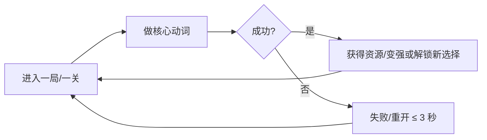

# 附录 A · 玩法创意发生器与 GDD 模板

> 这是一份**工具箱**，不是阶段计划。想不出点子、点子太多挑不出来、坑越挖越大的时候翻这一页。配套阅读：[[S2 核心循环与有趣度设计]]、[[S3 垂直切片与竞品拆解]]、[[附录 C 范围与功能裁剪决策卡]]。

## 1. 创意发生器：一个动词 × 一个幻想 × 一个限制条件

**用法**：三张表各随机取一行，拼成 `动词 + 幻想 + 限制`，然后**用 60 秒写出一句话玩法陈述**。写不出来就换组合，**一天最多组合 20 次**（超过 20 次是逃避开工）。

> [!tip] 为什么这三张表能生效
> **动词**决定"玩家每 30 秒在做什么"（玩法）；**幻想**决定"为什么他愿意做"（包装）；**限制条件**决定"范围有多大"（工期）。新手最常犯的错是先想世界观再想动词——那样做出来的通常是一个设定集，不是游戏。

### 表 1 · 动词（决定核心玩法）

| 动词 | 玩家实际在做什么 | 天然适合的品类 |
| --- | --- | --- |
| 砍 | 用攻击清出一条路 | 动作、清版、Roguelite |
| 收集 | 在有限时间内凑齐或筛选资源 | 探索、放置、经营 |
| 编排 | 排顺序、排布局，让连锁发生 | 解谜、自动化、卡牌 |
| 欺骗 | 利用信息不对称让对手/系统做错事 | 潜行、博弈、卡牌 |
| 守护 | 守住一个不想失去的东西 | 塔防、生存、护送 |
| 堆叠 | 把有限的空间/位置利用到极限 | 解谜、背包管理、建造 |
| 连接 | 把 A 和 B 接起来形成通路或组合 | 电路、管道、词条构筑 |
| 拆解 | 把复杂的东西拆开理解、再利用 | 逆向工程、恐怖、解谜 |
| 引诱 | 主动制造诱饵，让敌人走向你要的地方 | 潜行、塔防、RTS 微操 |
| 献祭 | 用长期资产换短期爆发 | Roguelite、卡牌、回合制 |
| 回溯 | 带着已知信息重做同一段时间 | 时间循环、解谜、Roguelite |
| 播种 | 提前投入，等待延迟收获 | 经营、农业、塔防 |
| 追击 | 主动缩短与目标的距离，把对方逼到死角 | 追逐、平台跳跃、动作 |
| 搬运 | 把东西从一处挪到另一处，路上有代价与风险 | 平台跳跃、解谜、物流经营 |

### 表 2 · 幻想（决定包装与情绪）

| 幻想     | 一句话情绪        | 备注                |
| ------ | ------------ | ----------------- |
| 落魄铁匠   | 一无所有但手上有技艺   | 天然适合"锻造/编排"类动词    |
| 星际邮差   | 在荒凉的地方维系联系   | 适合关卡式短局           |
| 失忆守夜人  | 不知道自己在守什么    | 适合氛围 + 解谜         |
| 末日后园丁  | 在废墟上种出一点绿    | 适合放置、经营           |
| 偷时间的贼  | 每偷一次都欠下一笔债   | 适合 Roguelite、资源交换 |
| 沉船打捞员  | 每下潜一次都是赌博    | 适合资源管理            |
| 深海观测员  | 记录未知，而不是征服未知 | 适合探索、图鉴           |
| 雨中送葬人  | 送别，但路很长      | 适合步行模拟、平台跳跃       |
| 地牢清洁工  | 别人打完，你来收拾    | 天然喜剧，适合解谜         |
| 被诅咒的厨师 | 做出的东西一定会带来后果 | 适合经营 + 随机         |
| 信号塔维护员 | 孤独地维持一条线路    | 适合节奏、自动化          |
| 动物园夜班  | 白天正常，晚上失控    | 适合塔防、生存           |

### 表 3 · 限制条件（决定范围与工期）

| 限制        | 对设计的影响           | 项目可控度 |
| --------- | ---------------- | ----- |
| 只能活 60 秒  | 强制短局、强制重开循环      | 极高    |
| 没有文字      | 省本地化，逼你用视觉教学     | 极高    |
| 一命通关      | 内容量可以小，难度要公平     | 高     |
| 屏幕不滚动（单屏） | 省相机与关卡工作量        | 极高    |
| 只有一次攻击    | 战斗系统极简，靠位置与时机    | 极高    |
| 没有血条      | 逼你做"受伤即变化"的反馈    | 高     |
| 只能向左移动    | 制造独特节奏，省一半关卡设计   | 高     |
| 白天/黑夜各一次  | 内容复用率高（同一场景两种玩法） | 高     |
| 所有敌人同样强   | 省数值设计，靠数量与位置     | 极高    |
| 弹药即货币     | 战斗与经济系统合并        | 高     |
| 只能带 3 件物品 | 选择变重，省背包 UI      | 极高    |
| 时间是唯一资源   | 省第二套经济系统         | 中     |

### 5 个组合示例（一句话玩法陈述）

1. **收集 × 沉船打捞员 × 只能带 3 件物品** ——《打捞者》是一个下潜探索游戏。玩家扮演氧气有限的打捞员，反复下潜收集沉船物资，通过选择"这次带哪 3 件"决定下一潜能到多深。
2. **编排 × 落魄铁匠 × 弹药即货币** —— 玩家扮演只有一座破炉子的铁匠，反复编排"熔炼—锻造—出售"的顺序，用打出去的每一发弹药当钱，靠更高效的火候顺序换更好的装备。
3. **欺骗 × 星际邮差 × 没有文字** —— 玩家扮演在敌对星区送信的邮差，反复欺骗检查站与海盗，通过伪装信件与航线，让谁都不知道包裹里是什么。
4. **守护 × 末日后园丁 × 时间是唯一资源** —— 玩家扮演在辐射区种树的园丁，反复在"出去找种子"和"留下浇水"之间分配一天的时间，用每一季多活下来的一棵树获得进展。
5. **引诱 × 地牢清洁工 × 只能活 60 秒** —— 玩家扮演只会拖把的地牢清洁工，反复用垃圾和血迹引诱怪物踩进陷阱，在一分钟一轮的打扫里清空整层。

## 2. 点子筛选打分表

**6 项各 1–5 分，合计满分 30（不加权）。先用 1 分钟给每个点子打一遍，只给"现在最想做的 3 个"打分，不要给 20 个点子打分。**

| 维度 | 1 分（危险） | 5 分（理想） | 点子 A | 点子 B | 点子 C |
| --- | --- | --- | --- | --- | --- |
| 核心动词是否有趣 | 只能靠剧情撑 | 单看动词就想试 | | | |
| 范围是否可控 | 心里没底 | 能说清 90 分钟内容清单 | | | |
| 内容量是否可组合 | 全靠手工堆 | 系统 × 组合能生内容 | | | |
| 美术可行性（一票否决项） | 需要大量新绘制资产 | 几何体/复用素材就能好看 | | | |
| 市场是否有同类成功案例 | 一个都找不到（也可能没需求） | 有 3 款小团队成功先例 | | | |
| 你愿意为它做 3 个月 | 想到就累 | 周末会自己想打开 | | | |
| **合计** | | | /30 | /30 | /30 |

> [!important] 阈值与一票否决
> - **≥ 24 分且无一票否决 → 立项**，直接进 [[S2 核心循环与有趣度设计]] 写一句话陈述；**18–23 分**：用 **1 天**做只验证核心动词的灰盒原型，好玩再立项；**< 18 分**：放弃，别改分——改分是自欺欺人的开始。
> - **一票否决**：美术可行性 ≤ 2 分，或你自己不想为它做满 3 个月（即上表「你愿意为它做 3 个月」这一项），无论总分多高都放弃。第一款游戏死于"画不出来"和"做腻了"的比例远高于死于玩法。
> - 分数**不要相信第一次的直觉**：写下一句话玩法陈述后再打一遍，两次差的维度就是你没想清楚的地方。

## 3. GDD 模板（可直接复制）

> [!tip] 用法：新建 `GDD - <游戏名>.md`，把下面这一节整个复制过去填空。**一页能写完最好**，超过 3 页说明范围太大；本模板与 [[S3 垂直切片与竞品拆解]]、[[附录 C 范围与功能裁剪决策卡]] 直接对接。

### 3.1 元信息

| 项 | 内容 |
| --- | --- |
| 游戏名（代号） | |
| 一句话玩法陈述 | |
| 品类 / 平台 / 引擎 | Godot 4.x + GDScript，Windows 优先，Steam |
| 目标单次体验时长 / 定价 | 90 分钟（或一局 5–20 分钟可重复）；经验值 ___ 美元 |
| 开发周期 / 成功定义 | 可玩内容开发 ≤16 周（W1–W14）；含上架与营销共 24 周（W1–W24）。每周 10–15 小时；上架、目标 ≥20 条评价（至少 10 条才显示评分）且好评率 ≥ 80%、收回成本 |

### 3.2 一句话玩法陈述（6 个空必须填满）

```text
《____》是一个【品类】游戏。
玩家扮演【谁】，为了【什么目标】，
反复做【一个动词】，通过【成长/变化方式】获得进展。
与其他同类不同的是【一个独特机制】。   ← 只许有一个
```

### 3.3 核心循环图



### 3.4 玩家体验描述（写完自己读一遍，能读通才算想清楚）

| 时间点 | 玩家在做什么 | 玩家的情绪/想法 |
| --- | --- | --- |
| 第 30 秒 | | 应该已经"懂了一个动作，并看到效果" |
| 前 3 分钟（180 秒内） | | 应该已经赢过一次 |
| 第 30 分钟 | | 应该已经有一个"我自己想出来的打法"（第 90 分钟应见过结局或明确收束） |

### 3.5 三圈功能表

| 圈 | 功能 | 备注 |
| --- | --- | --- |
| Must（不做就没有这个游戏） | ① ② ③ | 做到极致 |
| Should（让游戏更耐玩） | ① ② | 只排在内容量产之后 |
| Cut（这次不做） | ① ② ③ | 抄进 3.9 Not Doing |

### 3.6 控制表

| 操作 | 键鼠 | 手柄（后续） |
| --- | --- | --- |
| 移动 | WASD / 方向键 | 左摇杆 |
| 主行动（核心动词） | 鼠标左键 / J | A / X |
| 次行动 | 空格 / K | B / Y |
| 暂停 / 重开 | Esc / R | Start / Select（重开要快） |

### 3.7 UI 清单

- [ ] 主菜单（继续/新游戏/设置/退出）
- [ ] 游戏内 HUD（最少必要信息：状态 + 资源）
- [ ] 暂停菜单 + 设置（音量、窗口、键位）
- [ ] 死亡/结算界面（重开按钮显眼）
- [ ] 教程提示（≤ 3 屏）与 Credits（含素材署名，见 [[S4 资产管线与美术音频]]）

### 3.8 内容清单（这是工期的真正来源）

| 内容类型 | 数量 | 单件成本（小时，经验值） | 小计 |
| --- | --- | --- | --- |
| 关卡/房间 | | | |
| 敌人类型 | | | |
| 词条/道具 / Boss | | | |
| 音乐/音效 | | | |
| 合计 | | | ≈ __ 小时 |

### 3.9 美术风格锚点

| 项 | 决定 |
| --- | --- |
| 像素网格 / 基准分辨率 | 例：32×32；320×180，整数倍放大到 1080p |
| 缩放 | nearest neighbor（禁止出现糊边） |
| 调色板 | 16–32 色，文件：`调色板.aseprite` |
| 美术圣经 | 主角 / 场景 / UI 各 1 张（见 [[S4 资产管线与美术音频]]） |
| 明确不做 | 3D、骨骼动画、大量特效 |

### 3.10 Not Doing 清单（越写越省时间）

1.
2.
3.

### 3.11 里程碑表

| 里程碑 | 时间点 | 证据 | 状态 |
| --- | --- | --- | --- |
| M1 最小可玩 | W1 | 可运行 exe + 30 秒录屏 | [ ] |
| M2 垂直切片 + 商店页公开 | W6 | 5 分钟演示 + 5 份陌生人试玩 + Steamworks 注册、$100、商店页公开 Coming Soon | [ ] |
| M3 完整可通 | W14 | 可玩构建 + 自测清单 | [ ] |
| M4 Demo + 构建过审 | W18 | Demo 可下载 + 构建过审（商店页已在 W6 公开） | [ ] |
| M5 发售 + 复盘 | W24 | 销售页 + 复盘文档 | [ ] |

## 4. 竞品拆解表模板

> [!warning] 数据必须自己去抄
> 下表所有数字**都要你打开商店页现场记录**（日期一起记），不要凭记忆或让 AI 编。评价数与好评率会变，隔两周看一次趋势比看绝对值有用。

| 项 | 竞品 1 | 竞品 2 | 竞品 3 |
| --- | --- | --- | --- |
| 游戏名 | | | |
| 核心循环（一句话） | | | |
| 单局/单次时长 | | | |
| 系统数量（数一数） | | | |
| 定价（经验值区间） | | | |
| 评价数 | | | |
| 好评率 | | | |
| 它做对了什么（可借鉴） | | | |
| 它缺什么（**你的差异化机会**） | | | |
| 开发规模（几人/多久，估） | | | |
| 数据记录日期 | | | |

**拆解规则**：三款里至少一款是**单人/两人小团队**做的（否则参考价值低）；"它缺什么"一栏写完，回头检查你的 Must 功能里有没有真正回应它——如果没回应，你的差异化只是文案。

## 5. 适合个人第一款游戏的选题方向

> 共同点：**系统少、内容可组合、单次 90 分钟以内、不依赖美术量与剧情配音**。

| #   | 方向               | 核心动词    | 90 分钟内容怎么构成               | 为什么可控                     |
| --- | ---------------- | ------- | ------------------------- | ------------------------- |
| 1   | 单房间 Roguelite 清版 | 砍 / 引诱  | 8–12 波敌人 × 每波随机词条，一条命重开   | 无关卡美术，一套房间 + 换色即可；难度靠词条组合 |
| 2   | 推箱 / 空间解谜        | 堆叠 / 编排 | 25–35 个独立小关，每关 1 个新机制     | 关卡即内容，无战斗无数值；一关 2 小时能做完   |
| 3   | 词条构筑卡牌           | 连接 / 献祭 | 15 个事件节点 × 60 张卡池，2–3 局通关 | 全 UI 无角色动画；内容靠卡池组合，不靠绘制   |
| 4   | 小型自动化 / 放置经营     | 播种 / 编排 | 3 张地图 × 20 级产能解锁          | 数值驱动，无动作手感要求；内容用表格生成      |
| 5   | 章节式平台跳跃          | 追击 / 搬运 | 3 章 × 8 关，每关 2–4 分钟       | 复用同一套角色动画与 TileSet；难度靠摆位  |
| 6   | 时间循环侦探（单场景）      | 回溯 / 欺骗 | 一个场景 × 12 轮循环，每轮 6 分钟     | 只做 1 张地图；内容靠对话/线索组合，无战斗   |
| 7   | 短局街机 / 弹幕清版      | 砍 / 守护  | 一局 5–8 分钟，20 种敌人波次，刷分重玩   | 无剧情无关卡；靠波次生成撑时长           |
| 8   | 小体量经营模拟（摊位/小店）   | 收集 / 编排 | 30 天营业 × 每天 3 分钟决策        | 单场景 + 数值表；系统虽多但每个都很浅      |

> [!important] 选题的最后一关
> 把方向填进第 3 节模板，**如果"内容清单"算出的小时数超过你剩余时间的 60%，就换更小的方向**。第一款游戏的目标不是"够大"，而是"**完整、不亏、能交到下一个项目**"。

## 6. 常见坑

1. **一天组合出 50 个点子 / 给 20 个点子打分成瘾**：这是拖延症的精致伪装。20 个封顶，只给最想做的 3 个打分，然后立刻写一句话陈述。
2. **先定世界观再定动词**：做出的是设定集而不是游戏。**动词优先。**
3. **GDD 写成 20 页小说、独特机制写了三个**：写完没人看（包括你自己），三个机制必然做不完。**一页版 + 一个独特机制。**
4. **让 AI 帮你"估"市场数据 / Not Doing 空着 / 打分不落笔**：会得到看起来很专业的假数据；只在脑子里比较永远选不出来。价格与规模标"经验值"，评价数去商店页现场抄，然后写下来、排序、开工。
