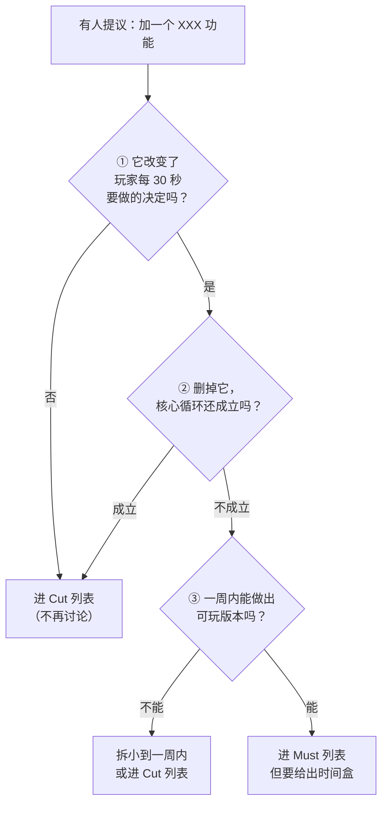

# 附录 C · 范围与功能裁剪决策卡

> 用法：**每次心里冒出"要不要加个 XXX"的时候，打开这一页，按流程走 3 分钟。**
> 独立游戏的第一死因不是技术不够，而是范围蔓延（Scope Creep）。这一页就是你的刹车。

## 1. 三问速判（不通过就别做）



**判定规则：任一项命中上面的裁撤条件，直接进 Cut 列表，不再讨论。**
（注意第 ② 问方向是反的：问的是"删掉它循环还成立吗"，答"**成立**"才是该砍；答"不成立"说明它是核心，进 Must。）

## 2. 功能准入表（每个新功能填一行）

| 功能 | 属于核心循环？ | 三问结果 | 预计工时（乐观） | ×2.5 修正 | 挤掉了哪个原计划 | 结论 |
| --- | --- | --- | --- | --- | --- | --- |
| 例：二段跳 | 否（微循环仍是挥剑） | ①否 → **命中裁撤条件** | 4h | 10h | 1 个敌人 | **Cut** |
| 例：武器升级树 | 是（成长感） | ①是 ②不成立（删了没成长） ③能 → 无命中 | 8h | 20h | 1 个 Boss | Must（W10） |
|  |  |  |  |  |  |  |

> [!important] "它挤掉了什么？"这一栏是这张表的关键
> 工时不是免费的。新功能一定挤掉了原本的某个内容。**写不出被挤掉的东西，说明你在凭空透支工期。**

## 3. 工期倒推算式（新手必须乘系数）

```text
可用工时 = 周数 × 每周小时数 × 0.6        ← 0.6 是现实系数（生活/生病/走神/返工）
功能估时 = 你的乐观估计 × 2.5             ← 新手系数（学习成本 + 调试 + 打磨）
总需求   = Σ 修正后工时 + 内容工时 + 测试与发布 20%
判据     = 总需求 ≤ 可用工时，否则砍
```

**示例（真实感算法）**：

| 项 | 数值 |
| --- | --- |
| 周期 16 周 × 12 h/周 × 0.6 | ≈ **115 h** |
| 预留测试/打包/发售（20%，约 23h） | 可开发 ≈ **92 h** |
| 一个"简单敌人"乐观 3h × 2.5 | ≈ 7.5 h |
| 一个"手绘 Boss"+ 行为逻辑乐观 8h × 2.5 | ≈ 20 h |
| 系统层（存档/设置/本地化）[[S6 系统层本地化与打包]] | ≈ 12 h |
| 结论 | 16 周大约只能做 **6~8 个敌人 + 1 个 Boss + 一套系统**。想要 20 个敌人 → 必须砍别的，或者按同一算式把周期拉到约 **32 周**（182h 需求 ÷ 0.8 ÷ 7.2h/周 ≈ 32 周） |

## 4. 成本乘数表（选品类时先看这一列）

| 要素 | 相对成本 | 说明 |
| --- | --- | --- |
| 2D 单机 | ×1 | 个人第一款游戏的基准 |
| 3D | ×3 起 | 建模、绑定、动画、光照、优化 |
| 联机（任意形式） | ×3 起 | 同步、断线、作弊、服务器、测试组合爆炸 |
| 长剧情 / 多结局 / 配音 | ×5 起 | 写作 + 本地化 + 演出 |
| 程序生成内容 | ×0.4（内容侧） | 系统成本换内容量，小团队最划算 |
| 手工关卡 | ×1.5~×2（内容侧） | 越到后期越贵，且无法复用 |
| 每多一个"系统" | 线性工时，**平方级 Bug** | 因为系统之间会互相作用 |
| 每多一种语言 | ×0.15（文本量） | 还有 UI 排版与测试成本 |

## 5. 降级阶梯（进度落后时，按这个顺序砍）

**从上往下砍，永远不要跳到最下面。**

| 顺序 | 砍什么 | 为什么可以砍 |
| --- | --- | --- |
| 1 | **元循环 / 解锁系统** | 微循环好玩，没有解锁也能上架 |
| 2 | 关卡 / 房间 / 敌人**数量**（保留种类） | 玩家感知的是种类，不是数量 |
| 3 | 次要系统（成就、图鉴、统计页） | 可以发售后再加 |
| 4 | 美术资产精度（统一降一档，但**保持风格一致**） | 一致性比精度重要 |
| 5 | 语言数量（只留简中 + 英文） | 见 [[S6 系统层本地化与打包]] |
| 6 | 单局长度 / 总内容量（90 分钟 → 45–60 分钟） | 短而精 > 长而糙 |
| — | **绝不砍**：核心动词打磨、教学引导、存档与设置、测试与兼容、商店页素材 | 砍了就是差评与退款 |

> [!warning] 唯一允许的"延期"理由
> 只有一种情况可以延期：**垂直切片的试玩数据表明玩法方向错了**，需要重新做切片。
> "内容还没做完"不是延期理由，那是范围问题，用上面的阶梯砍。

## 6. Cut 列表模板（写进 GDD，公开发布给自己）

| # | 想法 | 为什么砍 | 什么时候可能回来 |
| --- | --- | --- | --- |
| 1 | 多人合作模式 | 联机成本 ×3，第一款游戏不碰 | 第二款游戏 |
| 2 | 完整配音 | 成本不可控 | 不可能 |
| 3 | 8 个 Boss | 工期只够 2 个 | DLC / 续作 |
| 4 |  |  |  |

> 传说中的"以后再加"通常意味着永远不会加。写清楚"什么时候回来"，能有效减少反复纠结。

## 7. 每周五 15 分钟"范围体检"

- [ ] 本周实际完成 vs 计划完成：落后多少 %（超过 30% 就启动降级阶梯）
- [ ] 本周有没有新增未规划的功能？（有 → 补填准入表）
- [ ] 已完成的工时 vs 估算工时：系数是多少？（更新你的个人系数，替换掉 2.5）
- [ ] 下周要做的 Top 3，是否都在 Must 列表里？
- [ ] Cut 列表有没有变化？Not Doing 清单是否需要更新？
- [ ] 距离下一个"能给别人玩的构建"还有几天？（≤ 7 天是健康状态）

## 8. 自我欺骗话术与反驳

| 你心里会这么说 | 反驳 |
| --- | --- |
| "这个功能很简单，半天就够" | 填准入表，×2.5 后写进工期，再问"挤掉了什么" |
| "先做出来，好玩的话再砍别的内容" | 那就是在赌工期，赌输的代价是项目烂尾 |
| "别人都有这个功能，我没有会显得很寒酸" | 玩家买的是核心体验，不是功能清单 |
| "都做到这一步了，不舍得砍" | 沉没成本。已投入的工时不会因为你继续而回收 |
| "等美术资源来了再加" | 美术资源是按功能量估算的，功能一加，美术全部重估 |
| "发售后再补优化" | 差评不会等你。发售首周就定型了口碑 |

---
相关：[[README|独立游戏开发到 Steam 上线]] · [[S2 核心循环与有趣度设计]] · [[S5 内容量产与打磨]] · [[附录 A 玩法创意发生器与 GDD 模板]]
